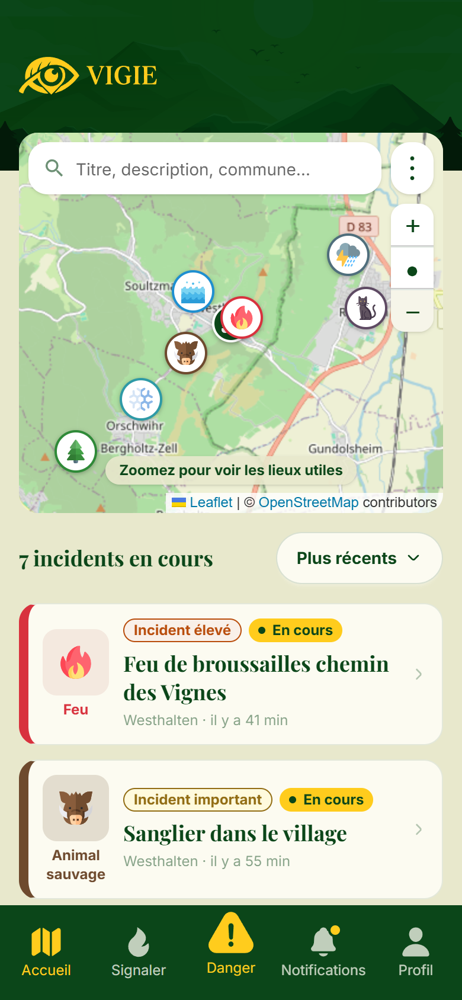
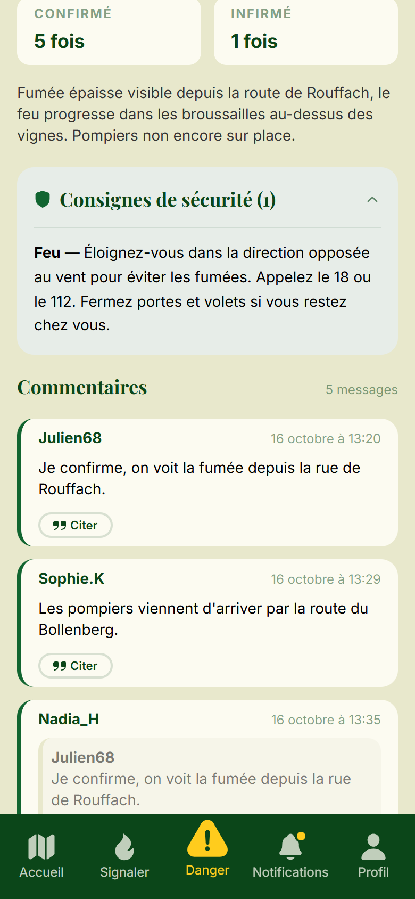
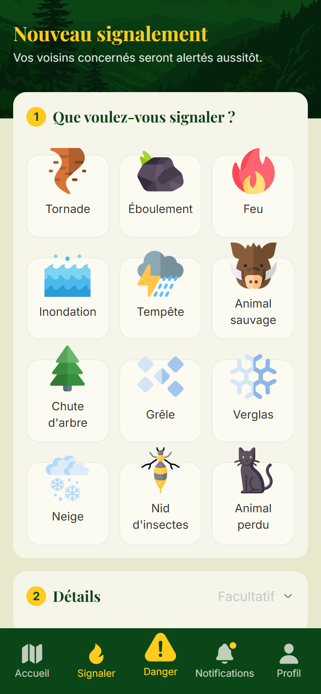
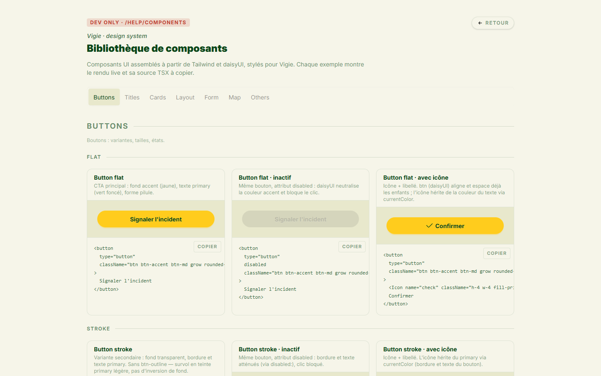

# Vigie

Neighbourhood alert app for natural hazards — a neighbour reports a fire,
flood, storm or stray animal, and everyone living inside the affected radius
is notified within the minute.

<p align="center">
  
  
  
</p>

<p align="center">
  
</p>

## Why

Existing services are single-hazard and national: a wildfire map, a flood
map, a weather alert feed. None of them tell you that the hazard is three
streets away, right now. Vigie is deliberately hyper-local — the
neighbourhood is treated as the first alert network, all hazards included,
on one live map.

Vigie warns neighbours. It does not contact emergency services, and the app
says so explicitly.

## Features

- **Geolocated reporting** — pick a hazard type, a severity and a position;
  the alert radius is derived from both and frozen at creation.
- **Neighbour alerts** — users whose address falls inside the radius are
  notified in-app and by web push.
- **Live map** — incidents and useful places (pharmacies, fire stations,
  shelters) pulled from OpenStreetMap.
- **Community confirmation** — neighbours confirm or deny a report, and
  each contribution recalculates the incident's expiry.
- **Comment threads** on each incident.
- **Weather vigilance** from the Météo-France API.
- **Accounts** — email/password or Google OAuth, email verification,
  badges, and full account deletion (GDPR).
- **Installable PWA** with push notifications.

## Stack

**Client** — React, TypeScript, Vite, React Router, Tailwind CSS, daisyUI,
SASS, Leaflet/OpenStreetMap.
**Server** — Node.js, Express, TypeScript, MySQL (raw SQL via `mysql2`, no
ORM), Argon2, JWT, web-push, nodemailer, node-cron, sharp.
**Tooling** — npm workspaces, Biome, Jest + Supertest, GitHub Actions,
Docker.

## Running it locally

Requires Node 20+ and a MySQL server.

```bash
git clone https://github.com/fredericbriand/vigie.git
cd vigie
npm install

cp server/.env.sample server/.env
cp client/.env.sample client/.env
# fill in at least DB_*, APP_SECRET and the VAPID keys
# (npx web-push generate-vapid-keys)

npm run db:migrate
npm run db:seed
npm run dev
```

The client runs on `http://localhost:3000`, the API on
`http://localhost:3310`.

Google OAuth, transactional email and the Météo-France vigilance feed each
need their own credentials — see `server/.env.sample`. The app runs without
them, with those features disabled.

```bash
npm run check   # Biome + type checking
npm test        # Jest + Supertest
```

## How it works

**Monorepo** — npm workspaces, `client/` and `server/`, one `npm run dev`
for both.

**No ORM.** Data access goes through hand-written SQL in `mysql2`, one
repository per domain module (`server/src/modules/`: incident, contribution,
badge, notifications, vigilance, usefulPlace…). The trade-off was deliberate:
explicit queries over a generated layer, on a schema we designed ourselves.

**Alert targeting** uses the haversine formula against each user's stored
address. `base_lifespan_hours` and `base_alert_radius_meters` are frozen on
the incident at creation, so editing a hazard type later never rewrites the
history of past alerts.

**Expiry is recalculated, not incremented.** Each contribution recomputes
the incident's expiry from the whole contribution set, which keeps the value
idempotent however the votes arrive. A `node-cron` job sweeps expired
incidents.

**Notifications are decoupled from channels.** A notification is persisted
once, then fanned out to the in-app feed and to web push, so a channel can
be added without touching the business logic.

**The design system documents itself.** A dev-only styleguide lives at
`/help` — component gallery, colour palette, icon gallery — built from the
same primitives the app uses, lazy-loaded and stripped from production
builds. It is how the five of us stayed consistent without a Storybook
instance to maintain.

**Accessibility (RGAA).** daisyUI is used for visual styling only;
interactive components are built on accessible primitives, because
CSS-only dropdowns and dialogs cannot carry the required keyboard and
screen-reader semantics.

The full design record — data model (MCD/MLD/MPD), business rules and
conventions — is in [VIGIE.md](VIGIE.md).

## Team and my role

Built in 8 weeks by a team of 5 as our final certification project.

I owned the transverse front-end architecture and the design system, and
worked across the stack on my user stories — from the React components down
to the SQL. The parts I'm most attached to: the expiry recalculation
service, the web push pipeline (VAPID, subscription lifecycle, sign-out
handling), the badge service, and their unit tests.

## Status

Certification project, delivered October 2026. Not actively maintained.

## License

MIT
