# Dossier projet — Vigie

> **Plan de travail** du dossier projet du titre professionnel Développeur web et web mobile (RNCP 37674). Volume visé : 40 à 48 pages, annexes non comprises. Un dossier efficace : chaque page doit prouver une compétence, pas de remplissage.
>
> Chaque section donne : la ou les compétences couvertes (C1 à C8), le contenu prévu, les sources où puiser, et un volume indicatif. Les blocs `> Sources` et `> Notes` sont des consignes de rédaction, à retirer du rendu final.
>
> **Règle d'écriture** : « nous avons » pour le travail collectif (US00, modélisation, `schema.sql` initial, seeders, routing, VIGIE.md, authentification) ; « j'ai » pour mon travail (charte graphique, design system, alias, Biome, US02, US07, US08, US12, US14, US15, US20, US21, US27). N'écrire que ce qui est prouvé (git, tests, captures).

> ### Note de mise en page — charte graphique Vigie
>
> Consigne pour la mise en page, à ne pas reproduire dans le dossier. Valeurs relevées dans `client/src/styles/theme.css`, `daisyui.css` et `client/index.html`.
>
> **Polices** (Google Fonts) — `https://fonts.googleapis.com/css2?family=Inter:ital,opsz,wght@0,14..32,100..900;1,14..32,100..900&family=Playfair+Display:ital,wght@0,400..900;1,400..900&display=swap`
>
> | Usage | Police | Repli |
> |---|---|---|
> | Titres | Playfair Display (serif, 400 à 900) | Georgia, serif |
> | Texte courant | Inter (sans-serif, 100 à 900) | system-ui, sans-serif |
> | Code | au choix (chasse fixe), ex. JetBrains Mono | monospace |
>
> **Couleurs de marque**
>
> | Rôle | Hexa | Usage conseillé dans le dossier |
> |---|---|---|
> | Primaire (vert profond) | `#0b4619` | titres, filets, en-têtes de tableau |
> | Secondaire (vert) | `#116530` | sous-titres, liens, badges |
> | Accent (jaune or) | `#ffcc1d` | touches ponctuelles (badge compétence, puces) ; jamais en texte sur fond clair |
> | Texte | `#333333` | texte courant |
> | Gris neutre | `#c9c9c9` | bordures, séparateurs |
> | Blanc | `#ffffff` | fond des pages |
>
> **Fonds** (beiges de l'application, pour encarts et blocs)
>
> | Rôle | Hexa |
> |---|---|
> | Fond arrière | `#e8e8cc` |
> | Fond des cadres | `#f6f5e9` |
> | Fond avant | `#fcfbf1` |
>
> **Couleurs sémantiques**
>
> | Rôle | Hexa | Note |
> |---|---|---|
> | Info | `#25a5e0` | |
> | Succès | `#116530` | = secondaire |
> | Avertissement | `#ffcc1d` | = accent |
> | Erreur | `#c1392b` | texte d'erreur sur fond clair : `#a32e22` |
>
> **Types d'incident** (couleur / fond clair) — contrastes corrigés au niveau AA
>
> | Type | Couleur | Fond |
> |---|---|---|
> | Feu | `#d8323e` | `#f4e9df` |
> | Inondation | `#1b7ab2` | `#e9efe7` |
> | Tempête | `#4f6e7c` | `#dfe2da` |
> | Tornade | `#b25d1c` | `#efe1cd` |
> | Grêle | `#3a75c2` | `#eef0e8` |
> | Verglas | `#267f89` | `#eaf0e5` |
> | Neige | `#3579ac` | `#f0f2e8` |
> | Éboulement | `#574a5e` | `#e0ddd6` |
> | Chute d'arbre | `#2d8436` | `#dae6d0` |
> | Animal sauvage | `#6e4a2e` | `#e3ddcf` |
> | Animal perdu | `#5e4a63` | `#e1ddd6` |
> | Nid d'insectes | `#946d00` | `#f4f0db` |
> | Danger (SOS) | `#c1392b` | `#fdf1ef` |
>
> **Niveaux de gravité** (couleur / fond clair)
>
> | Niveau | Couleur | Fond |
> |---|---|---|
> | 1 — Faible | `#36853b` | `#f8ffef` |
> | 2 — Modéré | `#687e20` | `#feffed` |
> | 3 — Important | `#926d14` | `#fffadd` |
> | 4 — Élevé | `#b94d0c` | `#f9f0e9` |
> | 5 — Critique | `#c1392b` | `#fdf1ef` |
>
> **Formes** — arrondis : petits éléments `1rem` (16 px), boutons et champs `0.25rem` (4 px), cartes et encarts `0.5rem` (8 px) ; bordures de `2px`. Espacements : 16 / 32 / 48 px.
>
> **Pour le dossier imprimé** : fond blanc, texte `#333333`, couleurs de marque en accent. Les beiges servent aux encarts (« Décision », blocs de code). Les couleurs de types et de gravité ne servent que pour illustrer l'application (captures, légendes), pas pour la structure du document.

**Compétences du référentiel**

| Code | Bloc | Compétence |
|---|---|---|
| C1 | Front-end | Installer et configurer son environnement de travail en fonction du projet web ou web mobile |
| C2 | Front-end | Maquetter des interfaces utilisateur web ou web mobile |
| C3 | Front-end | Réaliser des interfaces utilisateur statiques web ou web mobile |
| C4 | Front-end | Développer la partie dynamique des interfaces utilisateur web ou web mobile |
| C5 | Back-end | Mettre en place une base de données relationnelle |
| C6 | Back-end | Développer des composants d'accès aux données SQL et NoSQL |
| C7 | Back-end | Développer des composants métier côté serveur |
| C8 | Back-end | Documenter le déploiement d'une application dynamique web ou web mobile |

---

## 0. Couverture et sommaire

- Titre : Vigie — l'alerte entre voisins
- Nom, titre visé, organisme (Wild Code School), session
- Sommaire paginé

---

## 1. Introduction

Cet été, d'importants incendies ont touché la région bordelaise, où je vis. Autour de moi, j'ai entendu beaucoup de gens chercher à savoir ce qui se passait près de chez eux. Or les applications existantes suivent souvent un seul risque, sur tout un territoire. Ce qui manquait, c'était **une information à l'échelle du voisinage**.

C'est comme ça qu'est née l'idée de **Vigie, l'alerte entre voisins**. Il s'agit d'une application web, **pensée d'abord pour le mobile**, qui permet de **signaler un risque naturel près de chez soi** : feu, inondation, tempête, chute d'arbre, animal sauvage… Les voisins de la zone concernée sont alertés, et chacun peut confirmer ou infirmer un signalement. Les voisins deviennent ainsi **le premier réseau d'alerte**, quel que soit le risque.

J'ai proposé cette idée comme projet de fin de formation à la **Wild Code School**. Elle a plu à l'équipe, et nous avons développé Vigie ensemble pendant deux mois, d'août à octobre 2026, en nous organisant autour d'un backlog de user stories sur Trello.

Ce projet, c'est aussi l'aboutissement de mon parcours. Je viens de l'infographie et je me suis formé en 2017 au métier de webdesigner développeur front-end. Depuis, je construis des interfaces web : **six ans comme intégrateur front-end** chez Bizness x Actual Digital, à Toulouse, où j'ai conçu le design system d'une plateforme de formation en Angular, puis un an chez Send-Up, à Bordeaux, sur des applications Vue. Au fil de ces sept années, je me suis rapproché du développement, et l'envie de franchir le pas a grandi avec.

Je connaissais la Wild Code School depuis plusieurs années, et ses formations avaient bonne réputation. C'est donc vers elle que je me suis tourné. En mai 2026, j'ai intégré la formation **Développeur web et web mobile** : cinq mois en distanciel, jusqu'en octobre. J'y ai trouvé les compétences qui me manquaient pour passer de l'intégration au développement d'une application complète.

Dans ce dossier, je vais vous présenter Vigie, de l'expression des besoins jusqu'au déploiement. Vous y trouverez l'environnement technique, puis trois réalisations que j'ai menées. Suivront ma veille de sécurité et le déploiement. Vigie est pour moi la concrétisation de cette bascule, **de l'intégration vers le développement**.

---

## 2. Compétences couvertes par le projet

Vigie m'a permis de mobiliser les huit compétences du titre, côté front comme côté back. Le tableau ci-dessous sert de guide de lecture : pour chaque compétence, il indique les sections du dossier où vous en trouverez la preuve.

| Code | Compétence | Sections |
|---|---|---|
| **Bloc 1 · Front-end** | | |
| C1 | Installer et configurer son environnement de travail en fonction du projet web ou web mobile | 4.2 |
| C2 | Maquetter des interfaces utilisateur web ou web mobile | 3.3, 3.4 |
| C3 | Réaliser des interfaces utilisateur statiques web ou web mobile | 4.3, 5.3 |
| C4 | Développer la partie dynamique des interfaces utilisateur web ou web mobile | 5.1, 5.2, 5.3 |
| **Bloc 2 · Back-end** | | |
| C5 | Mettre en place une base de données relationnelle | 4.4, 5.3 |
| C6 | Développer des composants d'accès aux données SQL et NoSQL | 5.1, 5.2, 5.3 |
| C7 | Développer des composants métier côté serveur | 5.1, 5.2, 5.3 |
| C8 | Documenter le déploiement d'une application dynamique web ou web mobile | 7 |
| **Transverse** | Sécurité | 4.6, 6 |

*Tableau 1 — Correspondance entre les compétences du titre et les sections du dossier.*

### Développer la partie front-end d'une application web ou web mobile sécurisée

**C1 — Environnement de travail.** Nous sommes partis du monorepo fourni par la Wild Code School, qui réunit dans un même dépôt le client en React et TypeScript et le serveur en Express avec MySQL. Je l'ai ensuite adapté au projet côté front, notamment avec les alias d'import, l'installation de Tailwind et daisyUI.

**C2 — Maquettes.** J'ai défini la charte graphique de Vigie : ses couleurs, ses polices et ses codes visuels pour chaque type de risque. J'ai ensuite pris en charge l'essentiel des wireframes puis des maquettes, d'abord pour le téléphone, puisque Vigie est pensée pour être utilisée dehors et dans l'urgence.

**C3 — Interfaces statiques.** Dès le début du projet, j'ai traduit cette charte en design system : des couleurs et des espacements définis une seule fois dans le code, un jeu d'icônes et une galerie de composants que toute l'équipe pouvait reprendre. La page des badges (5.3) en est un exemple.

**C4 — Partie dynamique.** Avec React et TypeScript, j'ai développé des pages qui réagissent à l'état des données : chargement, erreur, élément introuvable ou contenu affiché. La fiche incident et la collection de badges en sont deux exemples détaillés.

### Développer la partie back-end d'une application web ou web mobile sécurisée

**C5 — Base de données.** Nous avons modélisé la base ensemble, en passant par le modèle conceptuel (MCD), le modèle logique (MLD) puis le modèle physique (MPD). J'ai ensuite fait évoluer le schéma pour mes fonctionnalités, notamment avec les tables des badges.

**C6 — Accès aux données.** Côté serveur, chaque module passe par un repository qui regroupe ses requêtes SQL, toujours paramétrées. J'y ai écrit les requêtes de mes fonctionnalités, par exemple pour rassembler toutes les informations d'un incident ou pour compter les actions qui débloquent un badge.

**C7 — Composants métier.** Avec Express, j'ai développé des routes qui appliquent les règles de Vigie : qui peut agir, dans quel ordre on vérifie, et comment un vote modifie la durée de vie d'un incident. Une partie de cette logique est isolée dans des fonctions testées.

**C8 — Déploiement.** La partie 7 documente la mise en production de Vigie : les conteneurs, les variables d'environnement et la procédure suivie.

**Sécurité.** Elle traverse tout le projet : authentification, contrôle des droits côté serveur, validation des entrées. La section 6 revient sur trois cas concrets.

---

## 3. Expression des besoins

> Volume : 5 à 6 pages

### 3.1 Le projet

#### L'idée de départ

Au départ, l'idée tient en une phrase : pouvoir signaler un incident près de chez soi et le partager avec son voisinage. Nous avons choisi de nous concentrer sur les risques naturels : feu, inondation, tempête, chute d'arbre, animal sauvage…

#### Le besoin central

Une alerte n'a de valeur que si elle arrive aux bonnes personnes. Le voisin qui habite à deux rues doit être prévenu vite ; celui qui habite à l'autre bout de la ville n'a pas à l'être.

**En une phrase : prévenir vite les voisins proches, sans alerter ceux qui sont loin.**

Tout l'enjeu est donc de partir d'un signalement pour retrouver les personnes à prévenir.

#### Les fonctions de base

Pour répondre à ce besoin, Vigie devait d'abord savoir faire quatre choses :

1. **Signaler un incident**, avec sa position sur la carte et son type de risque.
2. **Afficher les incidents** sur une carte, pour voir d'un coup d'œil ce qui se passe autour de soi.
3. **Prévenir les voisins** qui se trouvent dans le rayon de l'incident.
4. **Donner accès aux numéros d'urgence**, même sans compte.

#### Les défis à relever

Derrière ces fonctions se cachaient trois défis, que nous nous étions fixés dès le départ :

- **Retrouver les personnes à prévenir.** D'habitude, une application répond à « que se passe-t-il autour de moi ? ». Ici, c'est l'inverse : on part d'un incident pour trouver qui prévenir.
- **Fiabiliser les signalements, sans modérateur.** Il faut pouvoir faire confiance à une alerte, et ne pas laisser traîner une fausse alerte.
- **Protéger celui qui signale.** Signaler un risque ne doit pas exposer son identité ni son domicile.

#### Le parcours d'un incident

Une fois ces bases posées, l'incident devient le cœur de l'application. Il naît d'un signalement et vit le temps que dure le risque.

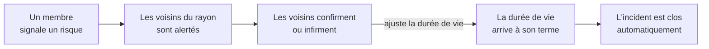

*Figure 1 — Le parcours d'un incident dans Vigie.*

- **Le signalement** : un membre choisit un ou plusieurs types de risque, place l'incident sur la carte, ajoute une description et, s'il le souhaite, une photo.
- **L'alerte** : les voisins dont l'adresse se trouve dans le rayon reçoivent un e-mail et, s'ils l'ont activée, une notification sur leur téléphone.
- **La contribution** : chaque membre peut confirmer ou infirmer l'incident. Une confirmation le prolonge, une infirmation le raccourcit.
- **La clôture** : une tâche planifiée clôt l'incident dès que sa durée de vie est écoulée.

Le rayon d'alerte et la durée de vie dépendent du type de risque. Une tornade concerne toute une commune mais passe vite ; un nid d'insectes ne concerne que la rue, mais reste là plusieurs jours.

| Type de risque | Rayon d'alerte | Durée de vie de départ |
|---|---|---|
| Tornade | 3 km | 2 heures |
| Feu | 2 km | 24 heures |
| Chute d'arbre | 200 m | 48 heures |
| Nid d'insectes | 50 m | 7 jours |

*Tableau 2 — Quelques types de risque et leurs réglages, sur les treize que compte Vigie.*

#### À qui s'adresse Vigie

Vigie s'adresse aux habitants d'un quartier. Tout le monde peut consulter les incidents, même sans compte : un lien partagé doit s'ouvrir pour tous. Agir, en revanche, demande d'être connecté.

| Ce que l'on peut faire | Visiteur | Membre connecté |
|---|---|---|
| Consulter la carte, la liste et les fiches d'incident | Oui | Oui |
| Recevoir les alertes de son quartier | Non | Oui |
| Signaler un incident | Non | Oui |
| Commenter, confirmer ou infirmer | Non | Oui |

*Tableau 3 — Ce que peuvent faire le visiteur et le membre.*

#### Dans quelles conditions

On n'ouvre pas Vigie tranquillement installé à son bureau. Le contexte d'usage a fixé nos exigences :

- **Dans l'urgence** → chaque écran doit pouvoir se lire en trois secondes.
- **Dehors, le téléphone à la main** → l'application est conçue pour le mobile.
- **Parfois sous le stress** → la rapidité passe avant l'exhaustivité : l'essentiel d'abord, le détail ensuite.

Ces exigences ont guidé toute la conception, des wireframes (3.3) à la charte graphique et aux maquettes (3.4).

#### Ce que Vigie n'est pas

Vigie prévient les voisins, mais elle ne contacte pas les secours. C'est une limite que nous avons choisie et que l'application affiche clairement : la page des numéros utiles et la fenêtre « Vous êtes en danger ? » invitent à appeler directement le 112, le 15 ou le 18.

### 3.2 Équipe, idéation et backlog

Nous étions cinq développeurs en formation, à distance, pendant deux mois : Laurent, Julien, Guillaume, Ivona et moi.

Entre l'idée et la première ligne de code, le projet est passé par deux outils, chacun avec son rôle : le Miro pour imaginer, le Trello pour organiser.

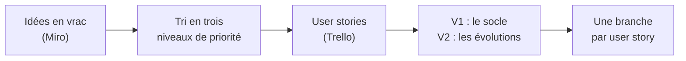

*Figure 2 — De l'idée au développement.*

#### Le Miro : imaginer, puis trier

Nous avons commencé par lister sur un tableau Miro tout ce que Vigie pourrait faire, sans nous censurer. Nous avons ensuite rangé chaque idée dans l'une de ces trois colonnes :

| À faire absolument | Ça serait bien | On est fous |
|---|---|---|
| Signaler un incident | Carte interactive | Notifications push, même navigateur fermé |
| Alerter la zone concernée | Confirmation par les voisins | Badges et gamification |
| Types d'incident détaillés | Bouton « Je suis en danger » | Réseau maillé entre téléphones |
| Cycle de vie et expiration automatique | Commentaires sur chaque alerte | Signalements générés automatiquement |
| Inscription et connexion | Bandeau de vigilance météo | |
| Numéros utiles et gestes de sécurité | Notifications dans l'application | |
| Alerte par e-mail | Partage sur les réseaux sociaux | |

*Tableau 4 — Extrait de la priorisation faite sur le Miro.*

La première colonne a donné le socle de l'application. Les deux autres ont nourri les évolutions : les notifications push et les badges, partis de la colonne « On est fous », ont finalement été réalisés. Le tableau Miro est présenté en annexe 1.

#### Le Trello : le backlog

Les idées retenues sont devenues des user stories, une carte Trello chacune. Chaque carte porte :

- **une version** : la V1, le socle livrable, ou la V2, les évolutions ;
- **une étiquette de priorité**, de 1 (à faire d'abord) à 3 (à faire en dernier) ;
- **un responsable**, qui la prend en charge jusqu'à sa fusion dans le projet.

Le backlog compte 28 user stories, détaillées en annexe 1. J'en ai pris en charge neuf, sept en V1 et deux en V2, en plus de la charte graphique (3.4) et du design system (4.3).

#### L'anatomie d'une user story

Une carte ne se contente pas d'un titre. Elle décrit tout ce qu'il faut pour développer la fonctionnalité sans avoir à reposer de questions :

1. **Le contexte** : pourquoi la fonctionnalité existe et pour qui.
2. **Les liens vers les wireframes et les maquettes** de l'écran concerné.
3. **Le parcours nominal** : ce qui se passe quand tout va bien.
4. **Les parcours alternatifs** : les cas d'erreur et les situations particulières.
5. **Les critères d'acceptation** : ce qui doit être vrai pour considérer la carte terminée.
6. **Les checklists techniques**, étiquetées [Front] ou [Back] : les tâches concrètes à réaliser.
7. **Le nom de la branche** à créer, sur le modèle `feat/US02-incident-details`.

### 3.3 Wireframes et UX — C2

Avant de dessiner le moindre écran, nous avons décrit ce que l'utilisateur fait, étape par étape. La conception s'est faite en trois temps :

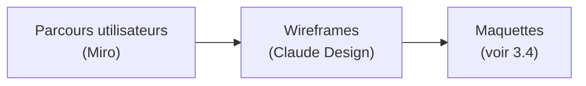

*Figure 3 — Les trois temps de la conception.*

#### Les parcours utilisateurs

Sur le Miro, chaque fonctionnalité a été découpée en parcours : de l'arrivée sur l'écran jusqu'à chaque action possible. Les post-its reprennent les couleurs de la priorisation (3.2) : **vert** pour « à faire absolument », **bleu** pour « ça serait bien », **rouge** pour « on est fous ». La priorité se lit donc dès le parcours.

> Notes : image — capture du parcours Miro « Afficher le signalement ».

*Figure 4 — Le parcours « Afficher le signalement » sur le Miro.*

Ce parcours pose déjà tout ce que la fiche d'un incident devra contenir :

- **les informations** : type, lieu, date, niveau de gravité, description, photo et pseudo de l'auteur ;
- **les actions** : commenter, partager, modifier son propre signalement ;
- **la fin de vie** : l'incident expire selon le temps écoulé et son type ; les confirmations des voisins le prolongent, les infirmations le raccourcissent.

#### Du parcours au wireframe

J'ai ensuite traduit ces parcours en wireframes avec Claude Design. L'exemple de la fiche incident montre ce passage : chaque post-it vert du parcours trouve sa place à l'écran (annexe 2).

Un wireframe ne montre pas seulement l'écran idéal. Il prévoit aussi ce que voit l'utilisateur dans chaque situation :

1. **Incident en cours**, pour un membre connecté.
2. **Visiteur non connecté** : la fiche se lit en entier, mais les actions demandent de se connecter.
3. **Incident résolu** : la fiche reste consultable, pour mémoire.
4. **Chargement** : la structure de la page s'affiche avant les données.
5. **Incident introuvable** : la fiche a été supprimée ou le lien est faux.

#### Ce qui a changé en chemin

Les parcours du Miro ont évolué avant d'arriver dans l'application :

| Dans le parcours Miro | Dans l'application |
|---|---|
| Un administrateur valide les signalements | Ce sont les voisins qui confirment ou infirment, sans administrateur |
| Le créateur change lui-même le statut de son incident | L'incident se clôt automatiquement à l'expiration |
| On répond à un commentaire | On cite un commentaire, dans un fil unique |

*Tableau 5 — Du parcours à l'application : ce qui a changé.*

#### Les principes UX

Les wireframes appliquent les exigences tirées du contexte d'usage (3.1) :

- **L'essentiel en haut** : gravité, statut, types de risque et auteur sont réunis dans un même encart.
- **Les actions à portée de pouce** : confirmer, infirmer et partager sont fixés en bas de l'écran.
- **Une navigation fixe**, identique sur tous les écrans : accueil, signaler, danger, notifications, profil.
- **Le visiteur n'est jamais bloqué** : il lit toute la fiche, et seules les actions l'invitent à se connecter.
- **Aucun écran sans issue** : la fiche introuvable propose de revenir à l'accueil ou de réessayer.

### 3.4 Charte graphique et maquettes — C2

Une fois la structure validée, il fallait habiller les écrans. La charte de Vigie répond à une question simple : comment alerter sans affoler ?

#### Une identité nature

Vigie parle de risques naturels. J'ai donc choisi des tons de terre et de forêt, pour une alerte qui rassure au lieu d'affoler.

| Rôle | Couleur | Usage |
|---|---|---|
| Le socle | Vert profond `#0b4619` et vert `#116530` | Titres, barre de navigation, boutons principaux |
| L'accent | Jaune or `#ffcc1d` | Ce qui doit ressortir : le bouton « Danger », le statut « En cours » |
| Les fonds | Beiges `#e8e8cc`, `#f6f5e9`, `#fcfbf1` | Le fond des pages et des encarts |

*Tableau 6 — Les couleurs de marque.*

Le vert et le beige forment le socle, calme et lisible. Le jaune est réservé à ce qui alerte : il attire l'œil parce qu'il est rare.

Côté typographie, deux polices se partagent le travail :

- **Playfair Display** pour les titres : une police à empattements, ronde et accueillante, qui prolonge l'identité nature ;
- **Inter** pour le texte : une police sans empattements, pensée pour rester lisible sur un petit écran.

#### Le logo

Le logo réunit les deux idées de Vigie : la **feuille**, pour la nature, et l'**œil**, pour la vigilance.

> Notes : image — le logo Vigie.

*Figure 5 — Le logo de Vigie.*

#### Deux codes couleur

En plus des couleurs de marque, deux codes couleur portent une information :

- **une couleur par type de risque** : rouge pour le feu, bleu pour l'inondation… Ces couleurs se sont imposées naturellement, à partir de l'élément lui-même ;
- **une couleur par niveau de gravité**, du vert au rouge.

| Type de risque | Couleur |
|---|---|
| Feu | Rouge `#d8323e` |
| Inondation | Bleu `#1b7ab2` |
| Chute d'arbre | Vert `#2d8436` |
| Nid d'insectes | Jaune miel `#946d00` |
| Animal sauvage | Brun `#6e4a2e` |
| Tempête | Gris ardoise `#4f6e7c` |

*Tableau 7 — Quelques couleurs de types de risque, sur les treize de Vigie.*

| Niveau | Gravité | Couleur |
|---|---|---|
| 1 | Faible | Vert `#36853b` |
| 2 | Modéré | Vert-jaune `#687e20` |
| 3 | Important | Ocre `#926d14` |
| 4 | Élevé | Orange `#b94d0c` |
| 5 | Critique | Rouge `#c1392b` |

*Tableau 8 — L'échelle de gravité.*

Une règle s'applique partout : **la couleur n'est jamais seule**. Un type de risque s'affiche toujours avec son icône et son nom, une gravité avec son libellé. Une personne qui distingue mal les couleurs ne perd donc aucune information.

#### Une iconographie vivante

Les types de risque étaient au cœur du projet dès le départ. Chacun a sa propre icône illustrée, reconnaissable d'un coup d'œil : la flamme, la vague, l'arbre, le sanglier… J'ai eu l'idée de les animer pour les rendre plus vivantes : la flamme qui vacille, l'arbre qui se balance.

Pour l'interface (navigation, alertes, profil), des icônes plus sobres, d'une seule couleur, laissent la vedette aux types de risque.

> Notes : image — planche des icônes (types de risque, puis icônes d'interface).

*Figure 6 — Le jeu d'icônes : les types de risque et l'interface.*

#### Du wireframe à la maquette

La maquette applique la charte aux wireframes de la fiche incident (3.3). La structure ne change pas ; la charte lui donne du sens :

- **le bandeau du titre prend la couleur du type de risque** : rouge pour un feu, bleu pour une inondation ;
- **les types s'affichent en étiquettes**, chacune avec son icône ;
- **le statut « En cours » ressort en jaune**, le statut « Résolu » passe au vert ;
- **la carte montre le rayon d'alerte** autour de l'incident ;
- **la barre de navigation** reprend le vert profond, avec le bouton « Danger » en jaune au centre.

Les maquettes de la fiche sont présentées en annexe 3.

---

## 4. Environnement technique

> Volume : 7 à 8 pages

### 4.1 Architecture et technologies

Vigie suit une architecture client-serveur en trois blocs : l'application dans le navigateur, notre API et la base de données. Le navigateur ne parle qu'à notre API : c'est elle qui interroge les services extérieurs, envoie les e-mails et les notifications.

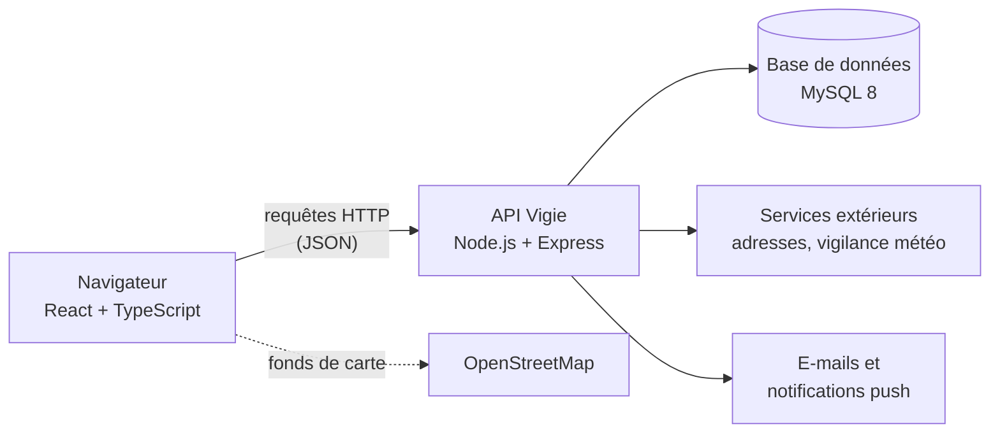

*Figure 7 — L'architecture de Vigie.*

Seule exception : les fonds de carte, de simples images, sont chargés directement depuis OpenStreetMap.

#### Les technologies

Le socle React, Express et MySQL nous était fourni par le monorepo de la Wild Code School. Nous l'avons complété selon les besoins de Vigie.

| Bloc | Technologie | Pourquoi |
|---|---|---|
| Front | React 19 et TypeScript | Des composants réutilisables, et un typage qui repère les erreurs avant même de lancer l'application |
| Front | Vite | Un serveur de développement rapide et une version de production optimisée |
| Front | React Router | La navigation entre les pages sans rechargement |
| Front | Tailwind CSS et daisyUI | Des styles écrits directement dans les composants, et des composants de base aux couleurs de notre charte |
| Front | Leaflet et OpenStreetMap | Une carte interactive libre et gratuite |
| Back | Node.js et Express | Le même langage, TypeScript, des deux côtés ; des routes simples à déclarer |
| Back | mysql2 | Le dialogue avec la base, avec des requêtes paramétrées |
| Back | Argon2 et JSON Web Token | Les mots de passe hachés, impossibles à retrouver même en lisant la base, et l'authentification (voir 4.6) |
| Back | node-cron | Les tâches planifiées, comme la clôture des incidents expirés |
| Back | sharp | Le traitement des photos sur le serveur |
| Back | Nodemailer, Brevo et web-push | L'envoi des e-mails et des notifications push |
| Base | MySQL 8 | Une base relationnelle, qui sait aussi calculer des distances entre deux points |

*Tableau 9 — Les technologies de Vigie.*

#### L'organisation du code

Côté serveur, le code est rangé **par domaine** : un dossier pour les incidents, un pour les commentaires, un pour les badges… Dans chaque domaine, une requête traverse les mêmes couches, et chaque couche n'a qu'un seul rôle.

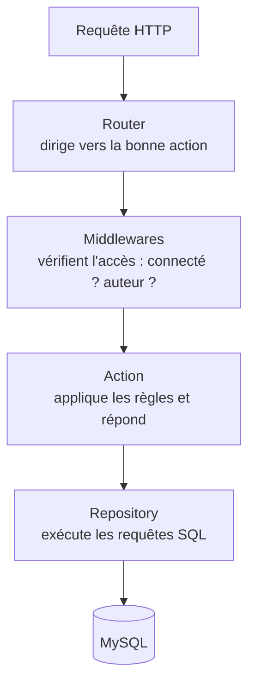

*Figure 8 — Le trajet d'une requête dans le serveur.*

Les **services** regroupent ce qui sert à plusieurs domaines : l'envoi des alertes, le traitement des photos, le calcul des distances…

Côté client, on retrouve la même logique :

- **les pages** : un écran de l'application, comme la fiche incident ;
- **les composants** : les morceaux réutilisables, comme une étiquette de type de risque ;
- **les services** : les appels à l'API, tous regroupés au même endroit.

Tous ces appels passent par une seule fonction, `apiFetch`. C'est elle qui ajoute le jeton de connexion à chaque requête, et qui déconnecte l'utilisateur si ce jeton n'est plus valide.

### 4.2 Environnement de travail — C1

#### Mon poste de travail

J'ai travaillé avec **Visual Studio Code**, enrichi de quatre extensions :

| Extension | À quoi elle m'a servi |
|---|---|
| Database Client | Travailler directement sur la base : lancer des requêtes, consulter et modifier les données. C'est l'outil que j'ai le plus utilisé |
| Thunder Client | Tester les routes de l'API sans passer par l'interface |
| Biome | Voir les erreurs de style et de qualité au fil de la frappe |
| Tailwind CSS IntelliSense | Compléter automatiquement les classes Tailwind |

*Tableau 10 — Les extensions de VS Code.*

La base de données MySQL 8 est installée directement sur ma machine.

#### Le monorepo

Nous sommes partis du monorepo fourni par la Wild Code School : un seul dépôt Git, qui contient à la fois le client et le serveur.

```text
vigie/
├── client/    l'application React (pages, composants, services)
├── server/    l'API Express et la base de données (schéma, données de test)
├── package.json    les commandes communes aux deux
└── .github/   les vérifications automatiques
```

*Figure 9 — L'organisation du dépôt.*

Une seule commande, `npm run dev`, lance le client et le serveur en même temps.

#### Ce que j'ai configuré côté front

Pendant l'initialisation du projet, j'ai adapté la partie client aux besoins de Vigie :

- **un alias d'import** : `@/components/…` remplace les chemins à rallonge comme `../../../components/…` ;
- **Tailwind CSS et daisyUI**, branchés sur notre thème (voir 4.3) ;
- **la configuration de Biome**, l'outil qui vérifie et formate le code, pour que toute l'équipe écrive de la même façon.

#### La base de données en local

Deux commandes suffisent pour obtenir une base prête à l'emploi :

1. `npm run db:migrate` crée toutes les tables à partir du schéma ;
2. `npm run db:seed` les remplit de données fictives : des utilisateurs, des incidents, des commentaires…

Ces données fictives permettent de tester la carte, les alertes ou les badges sans tout saisir à la main.

#### Les variables d'environnement

Les informations sensibles (mots de passe, clés d'accès) ne sont jamais écrites dans le code. Elles vivent dans un fichier `.env`, propre à chaque poste et exclu du dépôt. Un fichier `.env.sample`, lui versionné, liste les variables attendues sans leurs valeurs : il sert de modèle à chaque développeur.

| Famille | Exemples |
|---|---|
| Application | Port du serveur, clé secrète, adresse du client |
| Base de données | Hôte, utilisateur, mot de passe, nom de la base |
| E-mails | Serveur d'envoi et ses identifiants |
| Services extérieurs | Clés Google et Météo-France |
| Notifications push | Clés publique et privée |

*Tableau 11 — Les familles de variables d'environnement.*

#### Les vérifications automatiques

À chaque pull request, GitHub relance trois vérifications avant toute fusion :

1. **Biome** contrôle le style et la qualité du code ;
2. **TypeScript** vérifie les types, côté client comme côté serveur ;
3. **les tests unitaires** du serveur s'exécutent. J'ai ajouté cette dernière étape quand j'ai écrit les premiers tests du projet (voir 5.2).

### 4.3 Design system — C3

Le design system n'était demandé par aucune user story. C'est une initiative que j'ai prise pendant l'initialisation du projet, pour que toute l'équipe parte des mêmes bases visuelles. Sans base commune, chacun aurait réinventé ses couleurs, ses espacements, ses étiquettes, et l'application aurait vite perdu sa cohérence.

Tout le design system se consulte dans le navigateur, dans une zone de documentation que j'ai créée à l'adresse `/help`. Il repose sur trois piliers, chacun avec sa page :

| Pilier | Adresse |
|---|---|
| Une source unique pour les couleurs et les espacements | `/help/colors` |
| Un jeu d'icônes, du fichier SVG au composant | `/help/icons` |
| Une galerie de composants à copier | `/help/components` |

*Tableau 12 — Les trois piliers du design system et leur page dans `/help`.*

La zone `/help` réunit aussi la documentation du projet, lisible dans le navigateur. Elle n'existe que pendant le développement : lors de la construction de la version de production, tout son code est retiré. Les utilisateurs de Vigie n'y ont jamais accès, et l'application ne s'en trouve pas alourdie.

#### Une source unique : le fichier de thème

Toute la charte (3.4) est traduite en variables dans un seul fichier, `theme.css`. Chaque couleur y est déclarée une seule fois, puis utilisable partout :

```css
@theme static {
	--primary: #0b4619; /* vert profond */
	--accent: #ffcc1d;  /* jaune or */

	--fire: #d8323e;    /* couleur du type « Feu » */
	--bg-fire: #f4e9df; /* son fond clair */
}
```

*Extrait 1 — Quelques variables de `theme.css` (extrait simplifié, commentaires traduits).*

Une même variable sert de deux façons : en classe Tailwind dans un composant (`bg-fire`) ou en CSS classique (`var(--fire)`). daisyUI, qui fournit les boutons et les champs de base, puise lui aussi dans cette palette. Changer une couleur dans ce fichier la change donc dans toute l'application.

La page `/help/colors` affiche toute cette palette, rangée par famille : marque, sémantique, fonds, types de risque et gravité (annexe 4).

#### Les icônes : du fichier SVG au composant

J'ai mis en place toute la chaîne qui va du fichier d'icône jusqu'à son affichage dans l'application :

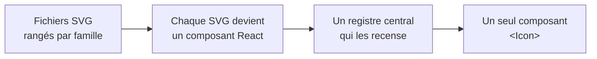

*Figure 10 — De l'image au composant : la chaîne des icônes.*

1. **Les fichiers SVG** sont rangés en trois dossiers, un par famille : la navigation, les types de risque et l'interface.
2. **Chaque SVG est importé comme un composant React.** L'icône reste du code, et non une image : elle reste nette à toutes les tailles, et les icônes d'interface peuvent prendre la couleur du texte qui les entoure.
3. **Un registre central** associe un nom simple à chaque icône : `fire`, `flood`, `share`…
4. **Un seul composant, `<Icon>`**, affiche n'importe quelle icône à partir de son nom :

```tsx
<Icon name="fire" />
```

*Extrait 2 — Afficher une icône.*

La liste des noms autorisés est déduite automatiquement du registre. Grâce à TypeScript, le composant n'accepte donc que des icônes qui existent : une faute de frappe, comme `name="fir"`, est signalée dans l'éditeur avant même de lancer l'application. Ajouter une icône demande seulement de déposer son fichier et de l'inscrire au registre.

La page `/help/icons` montre les 56 icônes du registre, avec le nom à utiliser pour chacune (annexe 4).

#### Une galerie de composants à copier

La galerie est organisée en onglets, un par famille : boutons, titres, cartes, mise en page, formulaires, carte interactive et étiquettes. Chaque exemple affiche **le rendu réel, et juste en dessous, le code à copier** (annexe 4).

#### Ce que l'équipe en a tiré

La galerie n'est pas une bibliothèque de composants à importer, mais une **référence à copier**. Ma fiche incident (US02), par exemple, en reprend directement le **bandeau de page** coloré selon le type de risque, ainsi que les **étiquettes** de statut (« En cours », « Résolu ») et de type de risque.

L'accessibilité était déjà intégrée aux exemples : les icônes décoratives sont masquées aux lecteurs d'écran, et aucune information n'est portée par la seule couleur. En copiant un exemple, on reprend aussi ces bonnes pratiques.

### 4.4 Modélisation de la base de données — C5

Nous avons modélisé la base ensemble, sur le Miro, en trois étapes : du plus abstrait au plus concret.

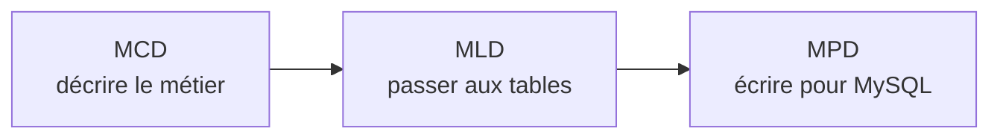

*Figure 11 — Les trois étapes de la modélisation.*

#### Un premier modèle, volontairement réduit

Notre premier MCD voulait tout prévoir : notifications, badges, connexion avec Google, notifications push… Trop complexe pour démarrer. Nous avons décidé ensemble de le réduire au minimum, et d'ajouter chaque élément au moment de développer la user story qui en aurait besoin.

> Notes : image — capture du premier MCD sur le Miro (entités en rouge = éléments écartés au départ).

*Figure 12 — Notre premier MCD sur le Miro. En rouge, les éléments écartés pour démarrer.*

Ce choix s'est révélé juste : la plupart des éléments écartés ont bien été ajoutés plus tard, mais un autre a été abandonné en route (voir « Un modèle qui grandit avec le projet »).

#### Le MCD : décrire le métier

Le modèle conceptuel décrit les données comme on en parle, sans technique. Voici le cœur de Vigie, à partir de la base actuelle :

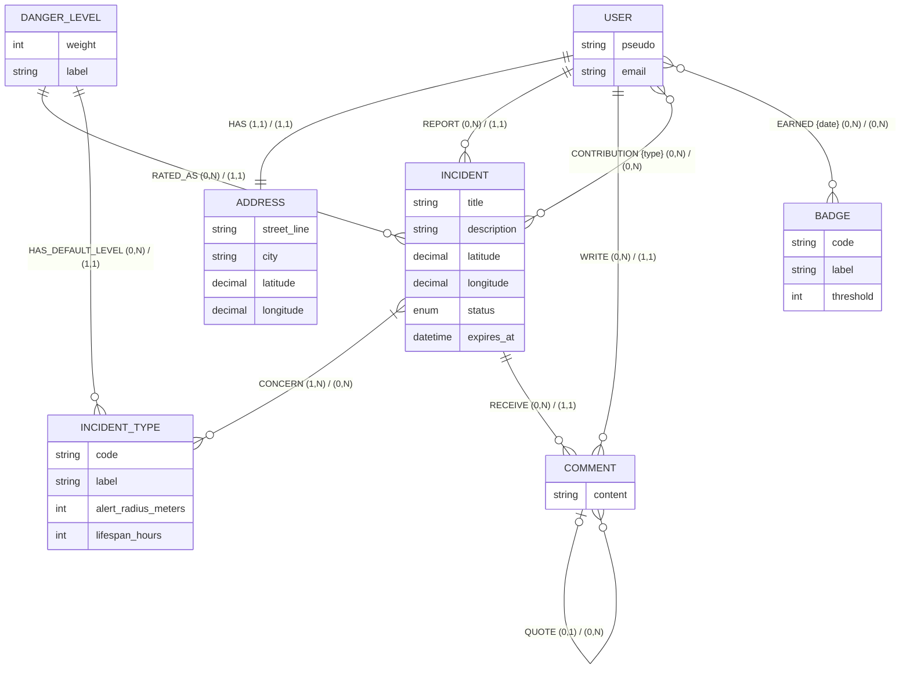

*Figure 13 — Le MCD de Vigie, recentré sur le cœur du métier.*

Il se lit avec quelques règles de gestion simples :

- un utilisateur a **une seule adresse**, et c'est par elle qu'il est alerté ;
- un incident porte **un ou plusieurs types de risque**, et un **niveau de gravité** ;
- un commentaire peut **citer un autre commentaire** du même fil ;
- un utilisateur peut **voter sur plusieurs incidents**, et un incident recevoir plusieurs votes. Le vote porte une information : confirmer ou infirmer ;
- un utilisateur peut **obtenir plusieurs badges**, et la date d'obtention est conservée.

#### Le MLD : passer aux tables

Le modèle logique traduit chaque entité en table. Les liens « un à plusieurs » deviennent des **clés étrangères** (notées `#`). Les liens « plusieurs à plusieurs » deviennent des **tables de jointure**, dont la clé primaire (soulignée) combine les deux clés étrangères.

- user (<u>id</u>, pseudo, email, password_hash, last_seen_at)
- address (<u>id</u>, street_line, city, insee_code, latitude, longitude, #user_id)
- danger_level (<u>id</u>, weight, label, color)
- incident_type (<u>id</u>, code, label, alert_radius_meters, lifespan_hours, color, #danger_level_id)
- incident (<u>id</u>, title, description, latitude, longitude, status, expires_at, #user_id, #danger_level_id)
- incident_incident_type (<u>#incident_id, #incident_type_id</u>)
- contribution (<u>#incident_id, #user_id</u>, type, created_at)
- comment (<u>id</u>, content, created_at, #user_id, #incident_id, #quoted_comment_id)
- badge (<u>id</u>, code, label, counter_type, counter_param, threshold)
- user_badge (<u>#user_id, #badge_id</u>, earned_at)

*Figure 14 — Le MLD des tables principales.*

La table `contribution` montre l'intérêt d'une clé composée : comme sa clé primaire est le couple incident + utilisateur, **c'est la base de données elle-même qui garantit qu'un voisin ne vote qu'une fois par incident**.

#### Le MPD : écrire pour MySQL

Le modèle physique précise les types MySQL et les contraintes. La table `incident`, au cœur de l'application, en donne un bon aperçu.

Chaque type a été choisi pour la donnée qu'il porte :

- **`DECIMAL` pour les coordonnées** : six chiffres après la virgule, soit une précision d'une dizaine de centimètres, sans les arrondis des nombres à virgule flottante ;
- **`ENUM` pour le statut** : la base n'accepte que « en cours » ou « résolu » ;
- **`SMALLINT` pour la durée de vie et le rayon** : des nombres entiers, sans besoin de grandes valeurs ;
- **`VARCHAR` avec une longueur maximale** pour les textes : un titre ne dépasse pas 80 caractères, une description 500 ;
- **`CHAR(5)` pour le code INSEE et le code postal** : toujours exactement cinq caractères.

```sql
CREATE TABLE `incident` (
    `id` INT UNSIGNED NOT NULL AUTO_INCREMENT,
    `user_id` INT UNSIGNED NOT NULL,
    `danger_level_id` INT UNSIGNED NOT NULL,
    `title` VARCHAR(80) NOT NULL,
    `description` VARCHAR(500) NULL,
    `photo_url` VARCHAR(255) NULL DEFAULT NULL,
    `latitude` DECIMAL(9, 6) NOT NULL,
    `longitude` DECIMAL(10, 6) NOT NULL,
    `base_lifespan_hours` SMALLINT UNSIGNED NOT NULL,
    `base_alert_radius_meters` SMALLINT UNSIGNED NOT NULL,
    `city` VARCHAR(150) NULL,
    `insee_code` CHAR(5) NULL,
    `postal_code` CHAR(5) NULL,
    `status` ENUM('in_progress', 'resolved') NOT NULL DEFAULT 'in_progress',
    `expires_at` DATETIME NOT NULL,
    `created_at` TIMESTAMP NOT NULL DEFAULT CURRENT_TIMESTAMP,
    `edited_at` TIMESTAMP NULL DEFAULT NULL,
    `updated_at` TIMESTAMP NULL DEFAULT NULL ON UPDATE CURRENT_TIMESTAMP,
    PRIMARY KEY (`id`),
    CONSTRAINT `fk_incident_user` FOREIGN KEY (`user_id`) REFERENCES `user` (`id`) ON DELETE CASCADE,
    CONSTRAINT `fk_incident_danger_level` FOREIGN KEY (`danger_level_id`) REFERENCES `danger_level` (`id`) ON DELETE RESTRICT
);
```

*Extrait 3 — La table `incident` dans `schema.sql` (index retirés pour la lisibilité).*

#### Un modèle qui grandit avec le projet

Les éléments écartés au départ ont été ajoutés au fil des user stories, au moment où elles en avaient besoin :

| Élément | User story | Devenir |
|---|---|---|
| Citation entre commentaires (`quoted_comment_id`) | US08 | Ajoutée |
| Badges (`badge`, `user_badge`) | US20 | Ajoutés (voir 5.3) |
| Abonnements aux notifications push (`push_subscription`) | US21 | Ajoutés |
| Connexion avec Google (`oauth_account`) | US22 | Ajoutée |
| Table des notifications (`notification`) | US09 | Abandonnée : remplacée par une simple date de dernière consultation sur l'utilisateur |

*Tableau 13 — Les évolutions du modèle.*

### 4.5 Routes de l'application

L'application a deux séries de routes : celles du **client**, qui correspondent aux pages que l'on voit, et celles de **l'API**, que le client appelle pour lire ou modifier les données.

#### Les routes du client

Le client compte une dizaine de pages principales, listées en annexe 5. Certaines sont ouvertes à tous, comme l'accueil et la fiche d'un incident. D'autres sont réservées aux membres, comme le signalement, les notifications et le profil.

Les pages réservées aux membres passent par un garde commun : un visiteur non connecté qui tente d'y accéder est redirigé vers la page de connexion. Toute adresse inconnue mène à une page « introuvable ».

#### Les routes de l'API

L'API compte 32 routes. Celles que j'ai développées sont listées en annexe 6.

Chaque route suit les conventions REST : l'adresse désigne la ressource, la méthode dit ce qu'on en fait. `GET` lit, `POST` crée, `PUT` remplace, `DELETE` supprime.

#### Les contrôles enchaînés avant l'action

Avant d'atteindre l'action, une requête traverse une suite de **middlewares**, chacun chargé d'une vérification. Si l'une échoue, la requête s'arrête là. Par exemple, pour corriger un incident :

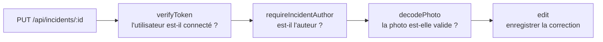

*Figure 15 — Les contrôles enchaînés sur la route de correction d'un incident.*

J'ai écrit `requireIncidentAuthor` et `decodePhoto`, visibles ici, ainsi que `attachUserIfPresent`, utilisé sur la lecture d'une fiche :

- **`requireIncidentAuthor`** vérifie que l'utilisateur est bien l'auteur de l'incident qu'il veut modifier ;
- **`attachUserIfPresent`** reconnaît l'utilisateur s'il est connecté, sans bloquer le visiteur. C'est lui qui permet à la fiche d'un incident de rester publique tout en indiquant à un membre s'il a déjà voté.

### 4.6 Sécurisation de l'application

Un principe guide toute la sécurité de Vigie : **le serveur a toujours le dernier mot**. L'interface peut masquer un bouton ou vérifier un formulaire, mais ce n'est qu'un confort pour l'utilisateur. Chaque règle est revérifiée côté serveur, car une requête peut toujours être envoyée sans passer par l'application.

#### Les protections en place

| Le risque | Ce que nous avons mis en place |
|---|---|
| Des mots de passe volés en cas de fuite de la base | Les mots de passe sont hachés avec Argon2id : on ne peut pas retrouver le mot de passe d'origine |
| Une session usurpée | Un jeton de connexion signé, valable une heure. Le serveur vérifie aussi que le compte existe toujours |
| Deviner quels e-mails sont inscrits | Un message identique, que l'e-mail soit inconnu ou le mot de passe faux : « Identifiant ou mot de passe incorrect » |
| L'injection SQL | Toutes les requêtes sont paramétrées : une saisie de l'utilisateur n'est jamais lue comme du code SQL |
| Une action interdite | Les droits sont contrôlés sur le serveur : être connecté, être l'auteur, avoir validé son e-mail pour signaler |
| Les abus et les robots | Au plus cinq signalements par heure et par membre ; inscriptions, renvois d'e-mail et recherches d'adresse limités par adresse IP |
| Des appels depuis un autre site | L'API n'accepte que les requêtes venant de l'adresse de l'application (CORS) |
| L'injection de code dans les pages (XSS) | React échappe automatiquement les textes affichés ; dans les e-mails, les caractères spéciaux sont échappés à la main |

*Tableau 14 — Les risques et nos protections.*

#### Ne renvoyer que le nécessaire

Une API peut laisser fuiter des données sans aucune faille : il suffit qu'elle en renvoie plus que nécessaire. C'est un risque classique, décrit par l'OWASP sous le nom d'exposition excessive de données.

Pour la fiche d'un incident, que tout le monde peut consulter sans compte, j'ai donc choisi précisément ce que la requête lit dans la table des utilisateurs : **le pseudo de l'auteur, et rien d'autre**.

```sql
SELECT
    i.id, i.user_id, i.title, i.description, i.photo_url,
    i.latitude, i.longitude, i.city, i.postal_code, i.insee_code,
    i.status, i.created_at, i.edited_at, i.expires_at,
    d.label AS danger_level_label,
    d.color AS danger_level_color,
    d.weight AS danger_level_weight,
    u.pseudo AS author_pseudo,
    u.anonymized_at AS author_anonymized_at
FROM incident AS i
INNER JOIN danger_level AS d ON d.id = i.danger_level_id
INNER JOIN user AS u ON u.id = i.user_id
WHERE i.id = ?
```

*Extrait 4 — La requête qui lit la fiche d'un incident (`incidentRepository.ts`).*

Pas de `SELECT *` : l'e-mail de l'auteur, son adresse ou ses informations de connexion ne quittent jamais la base. Même si une future colonne sensible était ajoutée à la table, elle ne serait pas exposée par erreur. La réponse est ensuite construite champ par champ (voir 5.1).

#### Le choix du jeton de connexion

À la connexion, le serveur renvoie un jeton signé (JSON Web Token), valable une heure. L'application le joint ensuite à chaque requête, dans l'en-tête `Authorization`.

- **Retenu** : le jeton transmis dans l'en-tête de chaque requête et conservé par le navigateur.
- **Écarté** : un cookie `httpOnly`, que nous avions prévu au départ.
- **Pourquoi** : l'équipe s'est alignée sur le modèle d'authentification vu en formation, qui utilise l'en-tête. **Limite assumée** : un jeton conservé par le navigateur reste lisible par un script ; une faille d'injection de code (XSS) permettrait de le voler. D'où l'importance de l'échappement des textes, et d'une durée de vie courte : une heure.

Enfin, trois cas concrets, que j'ai traités dans mes propres user stories, sont détaillés dans la veille de sécurité (section 6) : les notifications push, les photos et le contrôle de l'auteur.

### 4.7 Méthode de travail

L'organisation de l'équipe et le backlog ont été présentés en 3.2. Cette partie montre comment nous avons travaillé au quotidien : notre organisation, le circuit du code, la documentation, et ma façon de travailler avec l'intelligence artificielle.

#### Une organisation inspirée de l'agilité

Nous nous sommes inspirés de la méthode agile, sans en suivre tous les rituels à la lettre :

- **Une planification en équipe.** Ensemble, nous passions en revue les user stories, nous estimions grossièrement le temps que chacune demanderait, puis nous les répartissions entre nous.
- **Des points réguliers**, à la manière d'un daily : chacun disait ce qu'il avait fait, ce qu'il allait faire, et les difficultés qui le bloquaient.
- **Des échanges continus sur Discord**, par écrit ou en vocal, pour débloquer une question sans attendre le point suivant.

Les rituels n'étaient pas toujours formels, mais le suivi d'équipe était bien réel : chacun savait où en étaient les autres.

#### Le circuit Git

Chaque user story suivait le même chemin, de sa branche jusqu'à la version commune :

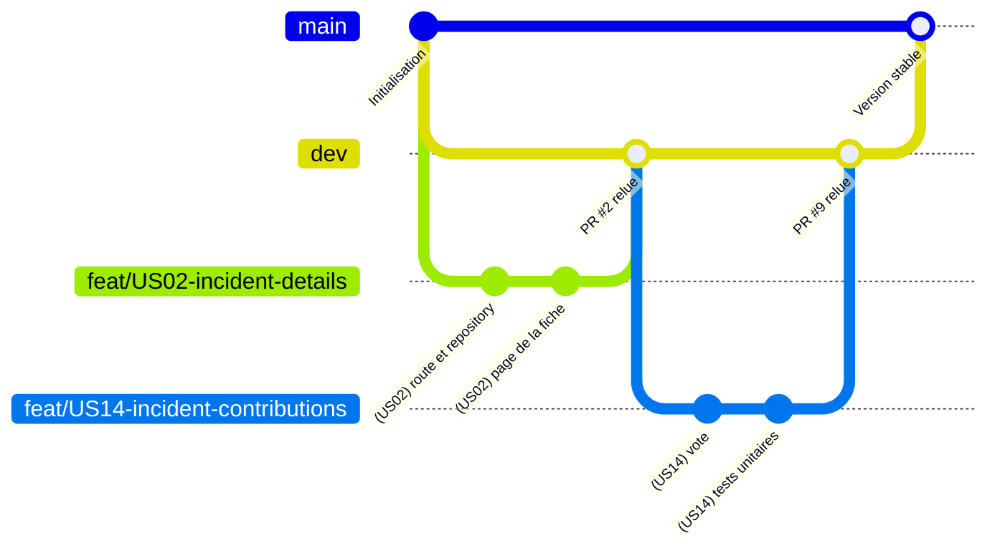

*Figure 16 — Le circuit des branches : chaque user story part de dev et y revient par une pull request relue ; main reçoit les versions stables.*

Sur chaque pull request, les vérifications automatiques (4.2) devaient d'abord passer. Ensuite, aucune pull request n'a été fusionnée sans avoir été relue par au moins un coéquipier. La revue permettait de repérer les erreurs, mais aussi de partager les choix de chacun avec le reste de l'équipe.

J'ai défini les conventions de nommage de l'équipe, et je les ai mises par écrit dans le Trello, avec des exemples :

| Élément | Convention | Exemple |
|---|---|---|
| Branche | Le type, le numéro de l'US et un nom court | `feat/US02-incident-details` |
| Commit | Le numéro de l'US entre parenthèses, puis l'action | `(US14) unit test for recalculateExpiry` |

*Tableau 15 — Les conventions de nommage.*

Ces conventions ont été suivies avec rigueur : plus de 9 commits sur 10 du projet portent le numéro de leur user story. On retrouve ainsi, pour chaque ligne de code, la fonctionnalité qui l'a fait naître.

#### Documentation et traçabilité

Nous nous appuyions sur quatre sources, chacune avec un rôle précis :

| Source | Son rôle | Ce qu'on y trouve |
|---|---|---|
| **Trello** | Le *quoi* | Le comportement attendu et les critères d'acceptation de chaque user story |
| **VIGIE.md** | Les *règles communes* | Le document de cadrage de l'équipe : le métier, les données, les conventions |
| **Git et les pull requests** | Le *comment* | L'historique du code et les échanges des revues |
| **Mon journal, fred.md** | Le *pourquoi* | Mes choix techniques : la décision, l'alternative écartée, les limites |

*Tableau 16 — Les quatre sources de documentation.*

Ces documents vivaient avec le projet :

- **VIGIE.md était daté à chaque révision.** Quand l'équipe a remplacé le cookie de session par un jeton dans l'en-tête, le 17 septembre 2026, la décision et sa conséquence y ont été consignées.
- **La carte suivait le code.** Quand un écart apparaissait entre une carte Trello et ce qui avait du sens dans le code, il était signalé, validé, puis la carte était corrigée, plutôt que de laisser les deux se contredire.
- **Mon journal était tenu au fil de l'eau**, au moment où chaque décision était prise, jamais reconstruit après coup. Il est la source principale des réalisations présentées en partie 5.

#### Travailler avec l'intelligence artificielle

J'ai utilisé deux outils d'Anthropic, et je le dis clairement :

- **Claude Design** pour les wireframes et les maquettes (3.3 et 3.4) ;
- **Claude Code**, un assistant de développement dans le terminal, pour écrire le code avec moi.

L'IA ne remplace pas la compréhension : elle accélère le travail, à condition de garder la main sur chaque décision. J'ai donc fixé un cadre, appliqué de la même façon à chaque user story :

1. **Une session par user story**, jamais une conversation fourre-tout.
2. **Le Trello fait foi** : les tâches viennent de la carte, pas de l'imagination de l'outil.
3. **Une tâche à la fois**, dans l'ordre que je choisis.
4. **L'approche est discutée avant le code** : fichiers touchés, compromis, alternative écartée. Rien n'est écrit sans mon accord.
5. **Une explication simple d'abord** quand un concept dépasse ce que j'ai vu en formation, puis le détail technique.
6. **Une vérification après chaque modification** (typage et qualité du code), pas seulement en fin de journée.
7. **Chaque décision est notée dans mon journal**, au moment où elle est prise.

Ce cadre m'a permis de comprendre et de défendre chaque ligne que je présente dans ce dossier. Quand une proposition ne me convenait pas, je la remettais en question plutôt que de l'accepter telle quelle.

---

## 5. Réalisations techniques

> Volume : 14 à 16 pages, environ 5 par réalisation ; extraits de code longs en annexe

### 5.1 La fiche incident (US02) — C4, C6, C7

La fiche d'un incident est le point d'arrivée de tous les parcours de Vigie : une alerte reçue, un clic sur la carte, un lien partagé, ou juste après avoir signalé. Elle doit se lire **sans compte**, et donner en quelques secondes de quoi décider quoi faire. J'ai développé cette user story seul, du 8 au 15 septembre 2026, de la base de données jusqu'à l'écran. Ses wireframes et ses maquettes sont présentés en annexes 2 et 3.

#### Le besoin

La carte Trello décrivait ce que la fiche devait permettre de comprendre :

| La question de l'utilisateur | Ce que la fiche affiche |
|---|---|
| De quoi s'agit-il ? | Le ou les types de risque, le niveau de gravité, le statut |
| Où ? | La commune et la position sur une carte |
| Depuis quand ? | La date et l'heure du signalement |
| Qu'en disent les voisins ? | Le nombre de confirmations et d'infirmations |
| Que sait-on de plus ? | Le titre, la description et la photo |
| Que dois-je faire ? | Les consignes de sécurité de chaque type de risque |

*Tableau 17 — Ce que la fiche doit dire.*

#### Côté serveur : reconstituer un incident complet

La route `GET /api/incidents/:id` est **publique** : aucune vérification de connexion ne la protège, puisque la fiche doit rester lisible par tous.

##### Pourquoi pas un simple `SELECT *` ?

Ma première idée était une seule requête : `SELECT * FROM incident WHERE id = ?`. Elle ne suffit pas. La base est normalisée (4.4) : la ligne d'un incident ne contient que ses propres colonnes et des clés étrangères. Elle ne porte ni le libellé de la gravité, ni le pseudo de l'auteur, ni les types de risque.

J'ai donc écrit **trois requêtes**, chacune adaptée à la forme de la donnée qu'elle va chercher :

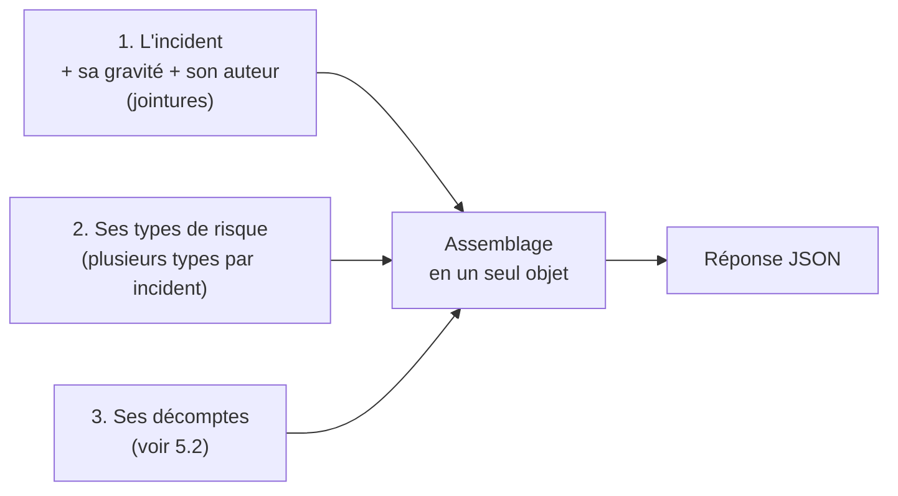

*Figure 17 — Les trois requêtes de la fiche incident.*

1. **L'incident, sa gravité et son auteur**, avec des jointures. Un incident n'a qu'une gravité et qu'un auteur : ces jointures ne dupliquent aucune ligne.
2. **Les types de risque**, dans une requête séparée. Un incident peut en avoir plusieurs : les joindre à la première requête aurait dupliqué la ligne de l'incident autant de fois qu'il a de types.
3. **Les décomptes de la communauté**, présentés avec le vote en 5.2.

Toutes ces requêtes sont paramétrées : l'identifiant passe par le `?`, jamais collé dans le texte de la requête.

##### Une réponse découplée de la base

Plutôt que de renvoyer les lignes brutes de la base, je construis la réponse champ par champ :

```ts
return {
	id: row.id,
	title: row.title,
	status: row.status,
	createdAt: row.created_at,
	dangerLevel: {
		label: row.danger_level_label,
		color: row.danger_level_color,
	},
	author: { pseudo: row.author_pseudo },
	types: typeRows.map((t) => ({ code: t.code, label: t.label })),
	counts,
};
```

*Extrait 5 — L'assemblage de la réponse (`incidentRepository.ts`, extrait simplifié).*

C'est un peu plus long à écrire, mais la réponse de l'API ne dépend plus des noms de colonnes : si une colonne est renommée en base, seul ce fichier change, et le front n'en sait rien. C'est aussi ce qui garantit qu'aucune donnée sensible ne fuite (4.6).

##### Des réponses d'erreur précises

L'action ne contient aucun SQL : il vérifie la demande, appelle le repository et traduit le résultat en réponse HTTP.

```ts
const id = Number(req.params.id);

if (!Number.isInteger(id) || id <= 0) {
	res.sendStatus(StatusCodes.BAD_REQUEST);
	return;
}

const incident = await incidentRepository.read(id, userId);
if (incident == null) {
	res.sendStatus(StatusCodes.NOT_FOUND);
	return;
}
```

*Extrait 6 — L'action de la fiche (`incidentActions.ts`, extrait).*

Un identifiant mal formé, comme `/api/incidents/abc`, reçoit une erreur **400** (demande invalide). Un identifiant correct mais inconnu reçoit une erreur **404** (introuvable). Les codes sont nommés (`StatusCodes.NOT_FOUND`) plutôt qu'écrits en chiffres, grâce à la bibliothèque `http-status-codes` : le code se lit sans avoir à connaître chaque numéro par cœur.

#### Côté client : une page à états

##### Quatre états, et pas un de plus

Une page qui charge des données peut se trouver dans quatre situations : en cours de chargement, affichée, introuvable, ou en erreur. Je les ai décrites avec un type TypeScript qui n'autorise que ces quatre cas :

```ts
type ViewState =
	| { status: "loading" }
	| { status: "ok"; incident: Incident }
	| { status: "notFound" }
	| { status: "error" };
```

*Extrait 7 — Les états possibles de la page (`IncidentDetails.tsx`).*

L'incident n'existe que dans l'état `ok`. Impossible, donc, d'afficher par erreur un incident pendant le chargement : TypeScript le refuserait. Chaque état a son écran, prévu dès les wireframes (annexe 2) : un squelette pendant le chargement, une page « introuvable », et une page d'erreur avec un bouton « Réessayer ».

##### Ne jamais afficher une réponse périmée

Imaginons qu'un utilisateur clique deux fois sur « Réessayer ». Deux requêtes partent. Si la première revient après la seconde, elle risque d'écraser une réponse plus récente.

Pour l'éviter, chaque requête reçoit un numéro, comme un ticket d'attente. Quand une réponse arrive, elle n'est affichée que si son numéro est celui de la dernière requête lancée :

```ts
const requestId = ++requestIdRef.current;
setState({ status: "loading" });

getIncidentById(id).then((result) => {
	if (requestId !== requestIdRef.current) return;
	setState(result.status === "ok" ? { status: "ok", incident: result.incident } : result);
});
```

*Extrait 8 — La protection contre les réponses en retard (`IncidentDetails.tsx`, extrait).*

##### Une page découpée en composants

La page assemble des composants, chacun chargé d'une partie de la fiche :

| Composant | Rôle |
|---|---|
| `IncidentHeader` | Les types de risque, la gravité, le statut, l'auteur et la date |
| `IncidentLocation` | La commune et une carte Leaflet centrée sur l'incident |
| `IncidentContent` | La description et la photo |
| `SafetyInstructions` | Les consignes de sécurité, dans un panneau qui se déplie |
| `IncidentActions` | Les actions possibles, selon que l'on est visiteur ou membre |

*Tableau 18 — Les composants de la fiche incident.*

##### Visiteur ou membre

La fiche ne passe pas par le garde des pages réservées (4.5) : elle doit rester ouverte à tous. Seules les actions changent : actives pour un membre connecté, elles invitent le visiteur à se connecter. Une fois l'incident résolu, le vote laisse la place à un bandeau.

La fiche et ses différents états sont visibles en annexe 7.

#### Une fiche qui sert de socle

La fiche est devenue le squelette sur lequel cinq autres de mes user stories se sont greffées : la correction (US07), les commentaires (US08), le vote (US14, voir 5.2), le partage (US15) et les badges de l'auteur (US20, voir 5.3). Elles sont décrites en annexe 8.

### 5.2 Confirmer ou infirmer un incident (US14) — C4, C6, C7

Un signalement repose sur la parole d'une seule personne. Cette user story donne aux voisins un moyen de dire ce qu'ils constatent sur place : l'incident est bien là, ou il ne l'est plus. Leurs avis pilotent la durée de vie de l'incident. Je l'ai développée seul, du 17 au 24 septembre 2026.

#### Le besoin

La carte Trello fixait les règles suivantes :

| La règle | Ce qu'elle veut dire |
|---|---|
| Un vote par voisin et par incident | On ne peut pas confirmer cinq fois le même incident |
| Changer d'avis remplace le vote | Passer de « confirmer » à « infirmer » ne s'additionne pas |
| Confirmer prolonge, infirmer raccourcit | Le vote modifie la date d'expiration de l'incident |
| La durée reste bornée | Jamais moins de zéro, jamais plus du double de la durée de départ |
| Seuls les voisins votent | L'auteur ne peut pas voter sur son propre signalement |
| Un incident résolu est figé | Plus aucun vote une fois l'incident clos |
| Voter demande d'être connecté | La fiche reste lisible par tous, mais le vote est réservé aux membres |

*Tableau 19 — Les règles du vote.*

#### La règle de calcul, isolée dans une fonction pure

Chaque incident a une **durée de base**, fixée à sa création selon son type de risque (la plus longue, s'il en a plusieurs). Les votes la font varier :

- **chaque confirmation** ajoute 15 % de la durée de base, avec un plafond de 4 heures par confirmation ;
- **chaque infirmation** retire 25 % de la durée de base ;
- **le résultat reste compris** entre 0 et deux fois la durée de base.

Pour un feu, dont la durée de base est de 24 heures, cela donne :

| Votes | Calcul | Durée de vie |
|---|---|---|
| Aucun | 24 h | 24 heures |
| 1 confirmation | 24 + 3,6 | 27,6 heures |
| 2 confirmations | 24 + 3,6 × 2 | 31,2 heures |
| 1 infirmation | 24 − 6 | 18 heures |
| 4 infirmations | 24 − 6 × 4 | 0 : l'incident est clos à la prochaine vérification |
| 20 confirmations | 24 + 3,6 × 20 = 96, plafonné | 48 heures, le double de la base |

*Tableau 20 — L'effet des votes sur un incident « Feu ».*

Toute cette règle tient dans une seule fonction :

```ts
const CONFIRM_BONUS_RATIO = 0.15;
const CONFIRM_BONUS_MAX_HOURS = 4;
const DENY_MALUS_RATIO = 0.25;

function recalculateExpiry(
	baseLifespanHours: number,
	createdAt: Date,
	counts: { confirm: number; deny: number },
): Date {
	const bonusPerConfirm = Math.min(
		baseLifespanHours * CONFIRM_BONUS_RATIO,
		CONFIRM_BONUS_MAX_HOURS,
	);
	const bonus = bonusPerConfirm * counts.confirm;
	const malus = baseLifespanHours * DENY_MALUS_RATIO * counts.deny;

	const durationHours = Math.min(
		Math.max(baseLifespanHours + bonus - malus, 0),
		baseLifespanHours * 2,
	);

	return new Date(createdAt.getTime() + durationHours * 60 * 60 * 1000);
}
```

*Extrait 9 — La règle de calcul (`contributionService.ts`).*

J'ai fait deux choix de conception :

- **Une fonction pure** : elle ne lit pas la base et ne modifie rien. Elle reçoit des valeurs et renvoie une date. On peut donc la tester avec de simples valeurs calculées à la main.
- **Un recalcul intégral** : à chaque vote, la date est recalculée à partir de tous les votes, et non ajustée petit à petit. Rejouer le calcul avec les mêmes votes donne toujours la même date : aucune erreur ne peut s'accumuler.

Cette règle est couverte par des tests unitaires, présentés plus bas.

La fonction ne fait que calculer la date d'expiration. Le passage au statut « Résolu » revient à la tâche planifiée de clôture (US12), qui clôt les incidents dont la date est dépassée.

#### Enregistrer un vote

Le vote passe par la route `POST /api/incidents/:id/contributions`, réservée aux membres connectés. Avant d'enregistrer quoi que ce soit, l'action vérifie la demande dans un ordre précis :

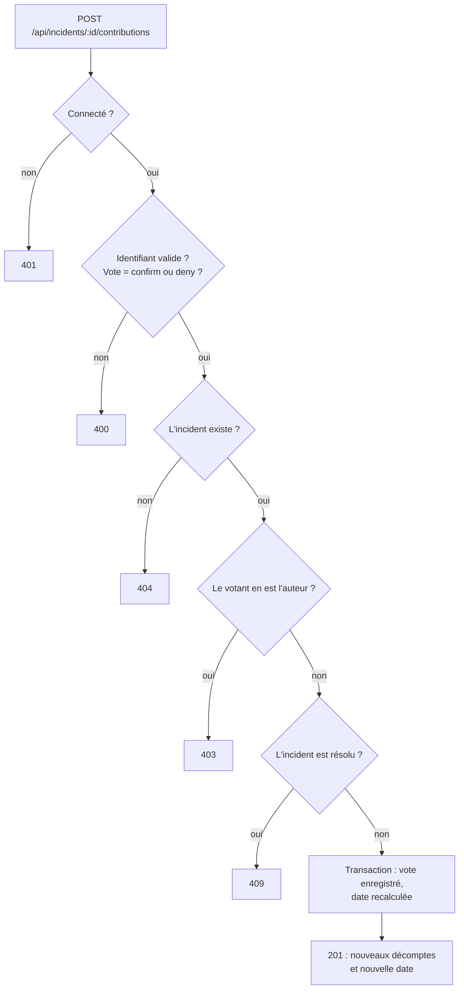

*Figure 18 — Les contrôles de la route de vote, dans l'ordre.*

L'ordre suit une logique simple : on rejette d'abord ce qui ne coûte rien à vérifier, puis ce qui demande une lecture en base. Le type du vote est contrôlé avant tout accès à la base : une valeur inattendue ferait sinon échouer la requête SQL et renverrait une erreur serveur (500) au lieu d'une réponse claire (400).

La règle « un vote par voisin » n'est pas vérifiée par le code : elle est portée par la base. La table `contribution` a une **clé primaire composée** du couple incident + utilisateur (4.4) : la base refuse d'elle-même une seconde ligne pour le même voisin. L'enregistrement s'appuie sur cette contrainte :

```sql
INSERT INTO contribution (incident_id, user_id, type)
VALUES (?, ?, ?)
ON DUPLICATE KEY UPDATE type = VALUES(type)
```

*Extrait 10 — L'enregistrement d'un vote (`contributionRepository.ts`).*

Cette requête insère le vote, ou le remplace si le voisin a déjà voté : c'est ce qu'on appelle un « upsert ». Je n'ai volontairement pas fait de lecture préalable pour savoir s'il avait déjà voté : entre cette lecture et l'écriture, un autre envoi aurait pu se glisser. Une seule requête ne laisse pas cette ouverture.

#### Deux voisins qui votent au même moment

Un vote se fait en trois étapes : compter les votes, calculer la date, l'écrire. Si deux voisins votent au même instant, chacun peut compter avant que l'autre ait écrit : le second écrit alors une date qui ignore le premier vote. Deux protections de la base de données répondent à ce problème :

- **la transaction** regroupe les étapes en un bloc « tout ou rien » : si le calcul échoue, le vote est annulé lui aussi ;
- **le verrou** (`SELECT … FOR UPDATE`), posé sur la ligne de l'incident au début de la transaction, fait attendre le second voisin jusqu'à la fin du premier. Il compte donc les votes en voyant celui du premier.

```ts
await connection.beginTransaction();
const { baseLifespanHours, createdAt } =
	await incidentRepository.lockBaseLifespan(incidentId, connection); // le verrou
await contributionRepository.create(incidentId, userId, type, connection);
const counts = await contributionRepository.countByIncident(incidentId, connection);
const expiresAt = contributionService.recalculateExpiry(baseLifespanHours, createdAt, counts);
await incidentRepository.updateExpiry(incidentId, expiresAt, connection);
await connection.commit(); // libère le verrou ; en cas d'erreur : rollback
```

*Extrait 11 — Le vote dans une transaction verrouillée (`contributionActions.ts`, extrait simplifié).*

Limite assumée : ce cas de votes simultanés repose sur ce raisonnement, il n'est pas couvert par un test automatique.

#### Tester la règle, et la vérifier automatiquement

##### Pourquoi des tests ici

Tout le reste de l'US (la route, les contrôles, la transaction, le verrou) ne sert qu'à amener les bonnes données jusqu'à `recalculateExpiry` et à enregistrer son résultat. Si la formule est fausse, toute la fonctionnalité l'est, même si chaque brique autour est irréprochable. Et cette erreur serait invisible : une date d'expiration un peu fausse ne se remarque pas à l'écran. Personne ne verrait, en cliquant trois fois sur « Confirmer », que le bonus aurait dû être de 3 heures et non de 3,6. La seule façon de s'assurer que la formule est exactement celle de la carte Trello est de la comparer, en code, à des valeurs calculées à la main.

##### Le jeu d'essai

J'ai écrit **sept tests unitaires** avec Jest, un par règle. Si une modification future casse quelque chose, le nom du test qui échoue indique directement la règle touchée.

| Cas testé | Données en entrée | Résultat attendu | Résultat obtenu |
|---|---|---|---|
| Sans vote | Base 24 h, aucun vote | 24 h | 24 h |
| Confirmations | Base 20 h, 2 confirmations | 20 + 3 × 2 = 26 h | 26 h |
| Plafond du bonus | Base 48 h, 3 confirmations | Bonus de 7,2 h plafonné à 4 h : 48 + 12 = 60 h | 60 h |
| Infirmations | Base 24 h, 2 infirmations | 24 − 6 × 2 = 12 h | 12 h |
| Borne basse | Base 24 h, 10 infirmations | 0 h, jamais négatif | 0 h |
| Borne haute | Base 24 h, 20 confirmations | 48 h, jamais plus du double | 48 h |
| Recalcul identique | Base 24 h, 3 confirmations et 1 infirmation, calculé deux fois | Deux fois la même date | Même date |

*Tableau 21 — Le jeu d'essai de la règle de calcul : sept cas, aucun écart.*

Chaque test suit le même schéma : des données en entrée, un appel à la fonction, et une comparaison avec le résultat calculé à la main. Le test du plafond, en annexe 9, en donne un exemple.

Les sept tests passent, sans aucun écart entre le résultat attendu et le résultat obtenu. Ce sont aussi les premiers tests unitaires du projet.

##### Les brancher sur les vérifications automatiques : un piège évité

Un test qui ne tourne que si l'on pense à le lancer ne protège personne. Or les vérifications automatiques des pull requests contrôlaient le style et les types, mais ne lançaient aucun test. J'ai voulu les y ajouter, et j'ai procédé par étapes :

1. **La solution évidente** : brancher la commande `test` déjà présente dans le projet.
2. **Le diagnostic, avant de le faire** : cette commande exécutait aussi `install.test.ts`, un test hérité du modèle de départ, qui a besoin d'une vraie base MySQL pour fonctionner. Or GitHub n'en fournit pas par défaut : toutes les pull requests auraient échoué, sans aucun rapport avec le code proposé.
3. **La solution retenue** : une commande séparée, `test:unit`, qui ne lance que les tests sans base de données. C'est elle seule qui a été ajoutée aux vérifications automatiques ; la commande `test` d'origine reste disponible en local.
4. **La limite notée** : les tests du projet qui ont besoin d'une base ne sont pas lancés automatiquement. Pour les y inclure, il faudrait ajouter une base MySQL aux vérifications.

Concrètement, ces vérifications sont décrites dans un fichier GitHub Actions, `.github/workflows/check.yml`. À chaque pull request vers `dev`, GitHub exécute ses étapes l'une après l'autre : Biome pour le style, puis `tsc` pour les types. J'y ai ajouté une dernière étape :

```yaml
- name: Run unit tests
  run: npm run test:unit --workspace=server
```

*Extrait 12 — L'étape ajoutée aux vérifications automatiques (`.github/workflows/check.yml`).*

L'option `--workspace=server` lance la commande dans la partie serveur du monorepo. Si un seul test échoue, l'étape échoue, et la pull request est marquée en rouge sur GitHub.

Depuis, toute pull request qui casserait la règle de calcul est signalée automatiquement, avant même d'être relue.

#### Côté client : les boutons de vote

##### Ce que voit chacun

Les boutons de vote s'adaptent à la personne qui consulte la fiche et à l'état de l'incident :


*Figure 19 — La zone de vote selon la situation : visiteur, membre qui n'a pas voté, membre qui a voté, incident résolu.*

L'auteur du signalement, lui, ne voit aucun bouton de vote. Les lui masquer est une question de confort, pas de sécurité : c'est le serveur qui refuse son vote (403), même si quelqu'un contourne l'interface.

##### Le trajet d'un clic

Au clic, les deux boutons se désactivent le temps de l'envoi : un double clic ne peut pas envoyer deux votes. Si le vote est accepté, la page reprend les nouveaux décomptes et la nouvelle date renvoyés par l'API, sans recharger la fiche. S'il est refusé, chaque code d'erreur du serveur devient un message clair, par exemple « Cet incident est résolu, il n'accepte plus de contributions ». Côté accessibilité, le vote exprimé ne repose pas sur la seule couleur : le libellé change aussi. L'attribut `aria-pressed` indique ce choix aux lecteurs d'écran, et une zone invisible leur annonce le résultat du vote.

### 5.3 Les badges (US20) — C3, C4, C5, C6, C7

Signaler, commenter, confirmer : tout ce qui fait vivre Vigie repose sur la participation des voisins. Les badges la rendent visible. Douze badges, répartis en trois familles lors de l'idéation sur Miro (par type d'incident, par volume, par comportement), récompensent cette activité. Je les ai développés seul, du 29 septembre au 6 octobre 2026. Côté front, l'US demandait deux choses : une page pour la collection, et un petit composant interactif affiché sous chaque pseudo.

#### Le besoin

| La règle | Ce qu'elle veut dire |
|---|---|
| Des badges calculés sur l'activité réelle | Signalements, commentaires et votes, recomptés à chaque connexion |
| Un référentiel stocké en base | Ajouter un badge ne demande aucune ligne de code |
| Un badge acquis reste acquis | Même si l'activité baisse ensuite |
| La collection complète sur le profil | Les badges obtenus, et la progression des autres |
| Les cinq derniers sous le pseudo | Sur la fiche incident et dans les commentaires |
| Réservé aux membres | Un visiteur voit le pseudo, mais pas les badges |

*Tableau 22 — Les règles des badges.*

#### Côté serveur : stocker et attribuer les badges

##### Deux tables, et un référentiel piloté par les données

L'US a demandé deux nouvelles tables. La table `badge` décrit chaque badge : son nom, sa condition, son icône, et surtout **ce qu'il compte** et **à partir de combien**. La table `user_badge` relie un membre aux badges qu'il a obtenus.

```sql
CREATE TABLE `user_badge` (
    `user_id` INT UNSIGNED NOT NULL,
    `badge_id` INT UNSIGNED NOT NULL,
    `earned_at` TIMESTAMP NOT NULL DEFAULT CURRENT_TIMESTAMP,
    PRIMARY KEY (`user_id`, `badge_id`),
    KEY `idx_user_badge_user_earned` (`user_id`, `earned_at`),
    CONSTRAINT `fk_user_badge_user` FOREIGN KEY (`user_id`)
        REFERENCES `user` (`id`) ON DELETE CASCADE,
    CONSTRAINT `fk_user_badge_badge` FOREIGN KEY (`badge_id`)
        REFERENCES `badge` (`id`) ON DELETE CASCADE
);
```

*Extrait 13 — La table `user_badge` (`schema.sql`, extrait).*

- **La clé primaire composée** `(user_id, badge_id)` garantit qu'un membre n'obtient jamais deux fois le même badge. Comme pour les votes en 5.2, c'est la base qui porte la règle, pas le code.
- **L'index** `(user_id, earned_at)` sert à retrouver rapidement les cinq badges les plus récents d'un membre.
- **Le type de compteur** est un `ENUM` de sept valeurs dans la table `badge` : MySQL refuse une faute de frappe, là où un simple texte l'accepterait.

Côté serveur, un badge est donc **une ligne de données** : « Pyromane », c'est le compteur `incident_by_type`, le paramètre `fire` et le seuil 5. Côté front, il lui faut aussi son icône. Ajouter un badge revient donc à ajouter une ligne en base et une image, sans modifier le code.

##### L'attribution à la connexion

À chaque connexion, le serveur recompte l'activité du membre et lui attribue les badges atteints. Ce calcul ne doit jamais ralentir ni bloquer la connexion : il part **après** la réponse.

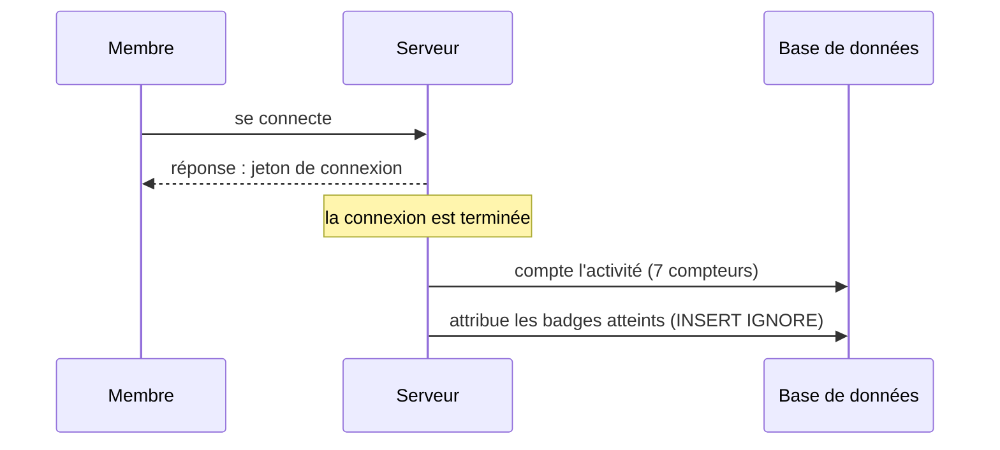

*Figure 20 — Le calcul des badges part après la réponse.*

`INSERT IGNORE` ignore les badges déjà obtenus : se connecter dix fois ne crée aucun doublon et ne change pas leur date d'obtention. Si le calcul échoue, l'erreur est journalisée, mais la connexion a déjà réussi. La comparaison entre compteurs et seuils est une fonction pure, couverte par dix tests unitaires.

#### Côté front : la collection sur le profil

##### Des icônes à la maquette

J'ai conçu les douze icônes des badges. Ma première maquette prévoyait trois états : obtenu, en cours, verrouillé (avec un cadenas). J'ai abandonné l'état « verrouillé » pour n'en garder que **deux** : obtenu, ou en cours avec sa progression, affichée même à zéro (« 0/5 »).

##### Une page construite à partir des données

La page `/profile/badges` affiche ce que renvoie l'API, sans aucun badge écrit en dur dans le code. Elle est découpée en composants imbriqués :

| Composant | Son rôle |
|---|---|
| `BadgeCollection` | Sépare les badges en deux listes : obtenus et à obtenir |
| `BadgeSection` | Affiche une liste avec son titre et son nombre (« Obtenus · 3 ») |
| `BadgeItem` | Affiche une carte : icône, nom, condition, état |
| `ProgressRing` | Dessine l'anneau de progression autour de l'icône |

*Tableau 23 — Les composants de la collection.*

Un treizième badge ajouté en base apparaîtrait sur cette page sans modifier un seul composant : il suffirait de déposer son icône avec les autres.

##### L'anneau de progression, en SVG

L'anneau est un simple dessin SVG, sans bibliothèque : un cercle de fond, et un second cercle dont seule une partie du contour est tracée.

```tsx
const RING_RADIUS = 34;
const RING_CIRCUMFERENCE = 2 * Math.PI * RING_RADIUS;

function ProgressRing({ current, target }: { current: number; target: number }) {
	const ratio = target > 0 ? Math.min(current / target, 1) : 0;

	return (
		<svg viewBox="0 0 80 80" aria-hidden="true" className="absolute inset-0 size-full -rotate-90">
			<circle cx="40" cy="40" r={RING_RADIUS} fill="none" strokeWidth="4" className="stroke-base-100" />
			{ratio > 0 && (
				<circle
					cx="40" cy="40" r={RING_RADIUS} fill="none" strokeWidth="4" strokeLinecap="round"
					strokeDasharray={`${ratio * RING_CIRCUMFERENCE} ${RING_CIRCUMFERENCE}`}
					className="stroke-accent"
				/>
			)}
		</svg>
	);
}
```

*Extrait 14 — L'anneau de progression (`BadgeCollection.tsx`, extrait).*

- **`strokeDasharray`** découpe le contour en un trait et un vide. Le trait mesure la part atteinte du périmètre : à 4/5, il couvre 80 % du cercle.
- **`-rotate-90`** fait partir l'anneau du haut, comme une horloge, et non de la droite.
- **`aria-hidden`** cache l'anneau aux lecteurs d'écran : il ne fait que doubler une information déjà écrite.

##### Un état qui ne repose pas sur la seule couleur

Un badge non obtenu est grisé, mais ce n'est pas le seul indice : sa carte indique « En cours · 4/5 ». Un badge obtenu garde ses couleurs et porte une coche suivie du mot « Obtenu ». L'état se lit donc même sans percevoir les couleurs.


*Figure 21 — La collection de badges sur mobile.*

#### Côté front : les badges sous le pseudo

##### Un petit format, et une infobulle

Sous le pseudo de l'auteur, sur la fiche incident et dans les commentaires, le composant `UserBadges` affiche ses cinq badges les plus récents, en icônes de 24 pixels. Une icône seule ne dit pas grand-chose : une infobulle donne son nom et sa condition.

La carte Trello imposait une infobulle **jamais au survol seul**. Sur mobile, le survol n'existe pas, et au clavier, il est inaccessible. Chaque badge est donc un vrai bouton :

| Action | Résultat |
|---|---|
| Clic, ou Entrée / Espace au clavier | Ouvre l'infobulle du badge |
| Nouveau clic sur le même badge | La ferme |
| Clic sur un autre badge | Ouvre la sienne à la place |
| Échap, ou clic ailleurs sur la page | La ferme |

*Tableau 24 — Les interactions de l'infobulle.*

##### Fermer l'infobulle proprement

Fermer avec Échap ou par un clic extérieur demande d'écouter toute la page, pas seulement le badge. Ces écouteurs ne sont posés que lorsqu'une infobulle est ouverte, et retirés dès qu'elle se ferme :

```tsx
useEffect(() => {
	if (openCode === null) return;

	const closeOnOutsidePress = (event: PointerEvent) => {
		const target = event.target as Element;
		const pressedTooltip = tooltipRef.current?.contains(target);
		const pressedBadge =
			containerRef.current?.contains(target) && target.closest("button") !== null;

		if (!pressedTooltip && !pressedBadge) setOpenCode(null);
	};
	const closeOnEscape = (event: KeyboardEvent) => {
		if (event.key === "Escape") setOpenCode(null);
	};

	document.addEventListener("pointerdown", closeOnOutsidePress);
	document.addEventListener("keydown", closeOnEscape);

	return () => {
		document.removeEventListener("pointerdown", closeOnOutsidePress);
		document.removeEventListener("keydown", closeOnEscape);
	};
}, [openCode]);
```

*Extrait 15 — La fermeture de l'infobulle (`UserBadges.tsx`, extrait).*

La fonction renvoyée à la fin de l'effet est le **nettoyage** : React l'exécute à chaque fermeture. Sans elle, chaque ouverture ajouterait de nouveaux écouteurs à la page, qui s'accumuleraient. Un clic sur un autre badge n'est pas considéré comme extérieur : il ouvre directement la bonne infobulle.

Côté lecteurs d'écran, chaque bouton porte le nom du badge (texte alternatif de l'icône) et l'attribut `aria-expanded`, qui indique si l'infobulle est ouverte. L'infobulle a le rôle `tooltip`, et `aria-describedby` la relie au badge ouvert.


*Figure 22 — L'infobulle ouverte sous le pseudo de l'auteur.*

Un visiteur, lui, voit le pseudo de l'auteur mais pas ses badges : le serveur renvoie une liste vide, sans même la lire en base.
---

## 6. Veille sur les vulnérabilités de sécurité

Vigie manipule des positions, des photos prises près de chez soi et des comptes : une faille y toucherait directement la vie privée des voisins. Pour savoir quoi surveiller, je m'appuie sur l'OWASP, une fondation qui publie le classement des risques les plus courants du web (le « Top 10 ») et des fiches pratiques pour s'en protéger. Trois cas, tirés de mes propres user stories, montrent comment cette veille s'est traduite dans le code.

### Les notifications push (US21) : empêcher le serveur d'être détourné

**Le risque.** Pour envoyer une notification, le serveur appelle le relais du navigateur du membre (Google pour Chrome, Apple pour Safari…), à une adresse fournie par ce navigateur. Mais un membre peut fournir une autre adresse. Le serveur est comme un coursier muni d'un badge : il entre dans le réseau interne de l'hébergeur, fermé au public. Si on lui donne l'adresse d'une machine interne, il y va. C'est la SSRF (*Server-Side Request Forgery*).

**L'erreur.** Mon premier filtre était une liste d'interdits (`localhost`, les adresses IP, les noms internes), mais il comparait du texte, sans vérifier où l'adresse menait. Après la relecture de ma pull request par un membre de l'équipe, j'ai réussi à le contourner :

| Adresse acceptée par le premier filtre | Pourquoi elle passait |
|---|---|
| `https://localhost./x` | Avec un point final, c'est la même machine que `localhost`, mais pas le même texte |
| `https://127.0.0.1.nip.io` | Un nom d'apparence publique, qui mène au serveur lui-même |

*Tableau 25 — Deux adresses piégées qui trompaient le premier filtre.*

**La correction.** Une liste d'interdits n'est jamais complète : une adresse peut toujours s'écrire autrement. J'ai donc inversé la logique avec une **liste blanche** : le serveur n'accepte plus que les quatre relais officiels (Google, Mozilla, Apple, Microsoft), tout le reste est refusé. J'ai testé à nouveau avec les adresses piégées : toutes sont refusées.

### Les photos (US27) : ne jamais publier la position du domicile

**Le risque.** Une photo de téléphone contient souvent des métadonnées (EXIF), dont les coordonnées GPS de l'endroit où elle a été prise, parfois le domicile. Le navigateur les retirait déjà en redimensionnant la photo, mais en testant un envoi direct à l'API, sans passer par le formulaire, la photo était stockée telle quelle, position comprise.

**La correction.** Le serveur ré-encode désormais chaque photo avec la bibliothèque `sharp`, qui n'écrit aucune métadonnée en sortie. Deux protections l'accompagnent :

- **le vrai format** est lu dans le contenu du fichier, jamais dans son extension ni dans ce qu'annonce le navigateur ;
- **les images aux dimensions démesurées** sont refusées : un fichier de quelques kilo-octets peut annoncer des millions de pixels et saturer la mémoire du serveur quand il l'ouvre. Le serveur lit les dimensions annoncées et refuse avant d'ouvrir l'image.

J'ai testé des photos avec position envoyées directement à l'API : elles sont enregistrées sans aucune métadonnée.

### La modification d'un incident (US07) : vérifier côté serveur

**Le risque.** L'auteur d'un signalement peut en corriger le titre, la description et la photo. Si ce contrôle n'existait que dans l'interface, n'importe quel membre pourrait modifier le signalement d'un autre, ou déplacer un incident sur la carte, en envoyant la requête à la main. Le contrôle d'accès défaillant est d'ailleurs le premier risque du Top 10 de l'OWASP.

**La correction.** Le bouton « Modifier » n'est affiché qu'à l'auteur, mais ce n'est qu'un confort : la vraie protection est sur le serveur, qui vérifie la demande dans un ordre précis.

- **L'incident existe-t-il ?** Sinon, 404.
- **La personne connectée en est-elle l'auteur ?** Sinon, 403.
- **L'incident est-il encore ouvert ?** Sinon, 409 : un incident résolu ne se modifie plus.

Les champs qui ne doivent jamais changer (position, types, gravité) sont protégés **par construction** : la requête SQL de modification ne les mentionne pas. Même si quelqu'un les ajoute à sa requête, ils ne peuvent pas être écrits.
---

## 7. Déploiement — C8

Vigie est en ligne depuis le 4 novembre 2026, sur la plateforme Railway. Le projet reste une démonstration étudiante : j'ai donc décidé de ne pas prendre de nom de domaine dédié et de garder l'adresse gratuite fournie par Railway.

### Le choix de la plateforme

Il me fallait un hébergement en HTTPS, indispensable aux notifications push, sans serveur à administrer.

| Option | Ce qu'elle impliquait | Décision |
|---|---|---|
| Louer un serveur (VPS) | HTTPS, mises à jour et sécurité à ma charge | Écartée |
| Séparer le front et le back sur deux hébergeurs | Échanges entre deux domaines (CORS) à gérer, alors qu'Express sait déjà servir le front | Écartée |
| Railway | MySQL hébergé, HTTPS fourni, construction à partir du `Dockerfile` du dépôt | **Retenue** |

*Tableau 26 — Les options d'hébergement comparées.*

### Comment ça marche

L'application est construite à partir d'un `Dockerfile` placé à la racine du dépôt. À chaque `git push` sur `main`, Railway en tire une nouvelle image et redéploie le service. La construction se fait entièrement sur ses serveurs : Docker n'est pas installé sur mon poste.

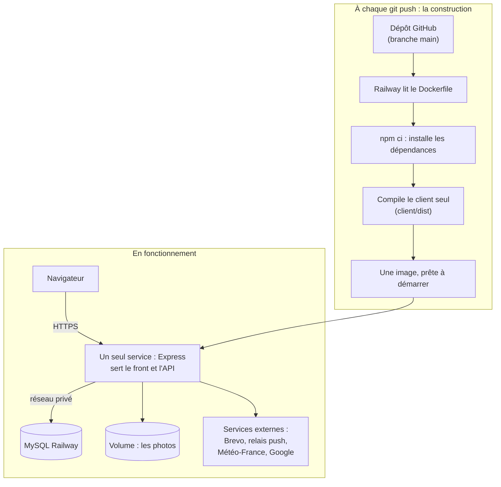

*Figure 23 — Un dépôt, un Dockerfile, une image, un seul service.*

Le serveur ne compile rien au démarrage : il sert un front déjà compilé. Le front et l'API partagent donc la même adresse, ce qui évite d'avoir à gérer le CORS.

### La procédure suivie

1. **Écrire le `Dockerfile`** à la racine du dépôt, et faire lire au serveur le port fourni par Railway (`PORT`).
2. **Créer le projet Railway** depuis le dépôt GitHub, avec une base MySQL, tous deux en région européenne pour rapprocher les données des utilisateurs.
3. **Renseigner les variables d'environnement** : l'accès à la base (`DB_*`), `APP_SECRET`, les clés des notifications push (`VAPID_*`), les clés des services externes, et les adresses du site. Aucun secret n'est écrit dans le dépôt.
4. **Appliquer le schéma une seule fois**, sur la base vide, avec `schema.sql`. Les fausses données de développement ne sont pas chargées : seul le référentiel (types d'incident, niveaux de danger, badges) est présent.
5. **Monter un volume** pour les photos.
6. **Tester en ligne** : inscription avec e-mail de vérification, connexion Google, géolocalisation, signalement avec photo, notifications push, vigilance météo.

### Trois problèmes rencontrés

| Problème | Solution |
|---|---|
| `npm run build` à la racine lance aussi une migration qui **supprime la base** : chaque déploiement aurait effacé les comptes et les signalements | L'image ne compile que le client (`npm run build --workspace=client`), et aucune migration ne se lance au démarrage |
| Les e-mails de vérification ne partaient pas : Railway bloque l'envoi par SMTP en dehors de son offre Pro. Sans e-mail, personne ne pouvait valider son compte | Envoi par l'API HTTPS de Brevo, qui passe par un port non bloqué. En local, rien ne change |
| Un conteneur est jetable : à chaque redéploiement, les photos enregistrées auraient disparu avec lui | Un volume monté sur `server/uploads`. J'ai vérifié qu'une photo s'affiche toujours après un redéploiement |

*Tableau 27 — Les problèmes rencontrés au déploiement.*

---

## 8. Conclusion

Vigie est partie d'une idée née après les incendies de l'été, autour d'un manque : *une information à l'échelle du voisinage*. À cinq, en deux mois, nous en avons fait **une application complète**, que j'ai ensuite mise en ligne.

Ce projet m'a permis de **mettre la main sur tous les aspects d'un développement**. Je connaissais déjà les interfaces. Ce que j'ai découvert se situe surtout derrière elles : modéliser une base de données, écrire du SQL, protéger une opération sensible, tester une règle métier, contrôler les droits côté serveur, déployer une application. J'ai aussi appris à **me projeter, dès la conception, dans un découpage technique** : passer d'une fonctionnalité imaginée à des tables, des routes et des composants. Cela a été complexe, mais extrêmement bénéfique.

Vigie a aussi ses limites, que nous avons assumées. Elle reste un projet de formation, elle ne couvre que les risques naturels, et elle est pensée pour le téléphone : elle est très peu adaptée aux grands écrans.

Plusieurs évolutions sont envisageables :

- retrouver ses anciens signalements ;
- être alerté selon sa position en direct, et non plus seulement selon son adresse ;
- enregistrer plusieurs adresses par compte ;
- ajouter les pages légales et la modification du mot de passe ;
- créer un réseau d'alerte qui fonctionne sans internet ;
- transformer Vigie en application mobile, et proposer une version pour ordinateur.

Ce projet a confirmé mon envie de devenir développeur. Je cherche désormais **un poste de développeur, plutôt front-end**, où je pourrai m'appuyer sur mes années d'intégration tout en comprenant ce qui se passe de l'autre côté de l'API. Et pour continuer à progresser, je prévois **de nouvelles applications et de nouveaux projets personnels**.

---

## Annexes

### Annexe 1 — De l'idéation au backlog

Le tableau Miro de l'idéation :

> Notes : image — capture du tableau Miro de l'idéation.

Le backlog complet, d'après le Trello au 5 octobre 2026 :

| US | User story | Priorité | Pris par moi |
|---|---|---|---|
| **V1 — Le socle** | | | |
| US00 | Initialiser le projet | — | En équipe |
| US01 | Signaler un incident et alerter les voisins concernés | 1 |  |
| US02 | Consulter le détail d'un incident | 1 | ✓ |
| US03 | Accéder à la liste des incidents | 2 |  |
| US04 | Afficher les incidents sur une carte interactive | 2 |  |
| US05 | S'inscrire avec son adresse | 2 |  |
| US06 | Se connecter | 2 |  |
| US07 | Corriger son incident | 2 | ✓ |
| US08 | Consulter et commenter un incident | 2 | ✓ |
| US09 | Recevoir ses notifications dans l'application | 2 |  |
| US10 | Rechercher et trier les incidents | 2 |  |
| US11 | Afficher la vigilance météo de son secteur | 3 |  |
| US12 | Clore automatiquement les incidents expirés | 3 | ✓ |
| US13 | Consulter les numéros utiles | 3 |  |
| US14 | Confirmer ou infirmer un incident | 3 | ✓ |
| US15 | Partager un incident | 3 | ✓ |
| US16 | Naviguer avec une barre fixe et un gabarit commun | 3 |  |
| US27 | Ajouter une photo à son signalement | 3 | ✓ |
| **V2 — Les évolutions** | | | |
| US17 | Lancer une alerte « Je suis en danger » | 1 |  |
| US18 | Accéder à son profil et modifier son pseudo | 1 |  |
| US19 | Réinitialiser son mot de passe | 2 |  |
| US20 | Obtenir des badges | 2 | ✓ |
| US21 | Recevoir les alertes même navigateur fermé | 3 | ✓ |
| US22 | Se connecter avec un compte Google | 3 |  |
| US23 | Être alerté selon sa position en direct | 3 |  |
| US24 | Gérer plusieurs adresses | 3 |  |
| US25 | Consulter les pages légales | 3 |  |
| US26 | Consulter ses propres signalements | — |  |

### Annexe 2 — Les wireframes de la fiche incident

Un écran, cinq états.

> Notes : image — planche des wireframes de la fiche incident (US02), cinq états.

### Annexe 3 — Les maquettes de la fiche incident

> Notes : image — planche des maquettes de la fiche incident (mêmes états que les wireframes, plus un incident d'inondation).

### Annexe 4 — Le design system dans `/help`

La palette de couleurs, à l'adresse `/help/colors` :

> Notes : image — capture de `/help/colors`.

Les icônes du registre, à l'adresse `/help/icons` :

> Notes : image — capture de `/help/icons`.

La galerie de composants, à l'adresse `/help/components` :

> Notes : image — capture de `/help/components`, onglet « Buttons ».

### Annexe 5 — Les routes du client

Les principales routes (les routes techniques de la connexion avec Google sont omises).

| Adresse | Page | Accès |
|---|---|---|
| `/` | Accueil : la carte des incidents | Tout le monde |
| `/incident/:id` | Fiche d'un incident | Tout le monde |
| `/numbers` | Numéros utiles | Tout le monde |
| `/login`, `/register` | Connexion, inscription | Tout le monde |
| `/verify-email` | Validation de l'adresse e-mail | Tout le monde |
| `/cgu` | Conditions générales d'utilisation | Tout le monde |
| `/incident/create` | Signaler un incident | Membre connecté |
| `/notifications` | Centre de notifications | Membre connecté |
| `/profile` | Profil | Membre connecté |
| `/profile/badges` | Collection de badges | Membre connecté |

### Annexe 6 — Les routes de l'API que j'ai développées

| Méthode | Route | Rôle | Accès | US |
|---|---|---|---|---|
| GET | `/api/incidents/:id` | Lire la fiche d'un incident | Tout le monde | US02 |
| PUT | `/api/incidents/:id` | Corriger son incident | Auteur de l'incident | US07 |
| GET | `/api/incidents/:id/comments` | Lire les commentaires | Tout le monde | US08 |
| POST | `/api/incidents/:id/comments` | Publier un commentaire | Membre connecté | US08 |
| POST | `/api/incidents/:id/contributions` | Confirmer ou infirmer | Membre connecté | US14 |
| GET | `/api/badges/me` | Lire ses badges | Membre connecté | US20 |
| GET | `/api/push-subscriptions/public-key` | Lire la clé publique des notifications push | Tout le monde | US21 |
| POST | `/api/push-subscriptions` | Activer les notifications push | Membre connecté | US21 |
| DELETE | `/api/push-subscriptions` | Désactiver les notifications push | Membre connecté | US21 |
| GET | `/uploads/:filename` | Afficher une photo | Tout le monde | US27 |

### Annexe 7 — La fiche incident dans l'application

Pour un membre, pour un visiteur, et une fois l'incident résolu :

> Notes : images — fiche-membre.png, fiche-visiteur.png, fiche-resolue.png, côte à côte.

Deux états prévus dès les wireframes, le chargement et la fiche introuvable :

> Notes : images — fiche-chargement.png, fiche-introuvable.png, côte à côte.

### Annexe 8 — Les user stories greffées sur la fiche

| User story | Ce qu'elle ajoute à la fiche |
|---|---|
| **US07** | **Corriger son incident**<br>L'auteur peut corriger le titre, la description et la photo de son signalement, fait souvent dans l'urgence. Le type, la position et la gravité restent verrouillés : ce sont eux qui ont décidé qui recevait l'alerte. La correction n'est possible que pour l'auteur, et tant que l'incident est en cours. |
| **US08** | **Commenter et citer**<br>Un fil de commentaires chronologique permet aux voisins de suivre l'évolution de l'incident. Il se lit sans compte, mais publier demande d'être connecté. On peut citer un autre commentaire, et son auteur est alors prévenu. Un commentaire publié ne se modifie plus. |
| **US14** | **Confirmer ou infirmer**<br>Le vote des voisins, qui ajuste la durée de vie de l'incident, est détaillé en 5.2. |
| **US15** | **Partager la fiche**<br>Un bouton partage la fiche avec un texte prérempli. Le menu de partage du téléphone s'ouvre quand il existe ; sinon, le lien est copié dans le presse-papiers. |
| **US20** | **Afficher les badges de l'auteur**<br>Sous le pseudo de l'auteur apparaissent ses cinq derniers badges obtenus, visibles par les membres connectés. Ils récompensent les voisins qui contribuent (voir 5.3). |

### Annexe 9 — Le test du plafond

Extrait de `server/src/modules/contribution/contributionService.test.ts`.

```ts
test("le bonus par confirmation est plafonné à 4h, même sur une longue durée de base", () => {
	const expiresAt = contributionService.recalculateExpiry(48, createdAt, {
		confirm: 3,
		deny: 0,
	});

	// bonus brut par confirmation = 48 * 0.15 = 7.2h, plafonné à 4h, x3 = 12h
	expect(expiresAt).toEqual(hoursAfter(60));
});
```
